# ASO (Skynet) Architecture

This document describes how ASO works. Sections marked **(planned)** are designs for phases not
yet implemented; everything else reflects the code. Diagrams are Mermaid and render on GitHub
and in most Markdown editors.

1. [Design principles](#1-design-principles)
2. [Deployment topology](#2-deployment-topology)
3. [Components and packages](#3-components-and-packages)
4. [Communication protocol](#4-communication-protocol)
5. [Node lifecycle](#5-node-lifecycle)
6. [Hardware-aware routing](#6-hardware-aware-routing)
7. [Task lifecycle](#7-task-lifecycle)
8. [Git flow](#8-git-flow)
9. [Package changes (dependencies and scripts)](#9-package-changes-dependencies-and-scripts)
10. [LLM gateway and agent loop](#10-llm-gateway-and-agent-loop)
11. [Agent roles and planning](#11-agent-roles-and-planning)
12. [Authentication](#12-authentication)
13. [Distribution and updates](#13-distribution-and-updates)

---

## 1. Design principles

- **Hub and spoke.** Every message goes through the Hub. Agents never talk to each other.
- **Central control, local execution.** The Hub owns planning, routing, the canonical Git repo
  and LLM access. Workers own file edits, compilation and tests on their own hardware.
- **Pushed state is the truth.** Anything not pushed to the Hub can be thrown away. Workers
  reset their checkout before every job, and reassigned tasks restart from the last pushed
  branch.
- **Untrusted input everywhere.** Every WebSocket frame, API body and Git push is validated
  before use. The Hub also checks what workers already checked themselves.
- **No raw Git or package manager for agents.** Agents edit files. Branching, committing,
  pushing and dependency changes go through narrow, typed wrappers.
- **The orchestrator is separate from the projects.** ASO runs from its own install and
  operates on the git repositories in its projects folder (`--root`, default `~/aso-projects`).
  It serves several projects at once with one shared pool of workers.

## 2. Deployment topology

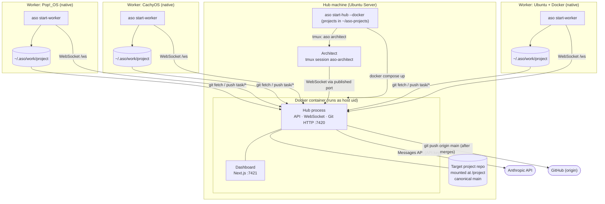

### Two ways to run the Hub

| | `aso start-hub --docker` | `aso start-hub` |
|---|---|---|
| Hub + dashboard | `docker compose up --build` (attached, logs stream to the terminal) | In-process, with the dashboard as a child process |
| Architect | tmux on the host; connects after `/api/health` answers | tmux on the host |
| Target repo | Bind-mounted at `/project` | Used in place |
| Use for | Deployment | Development and tests |

**Container details:**

- **User.** The Hub runs as the invoking user's uid and gid (`ASO_UID`/`ASO_GID`), so files it
  writes into the mounted project keep the right owner.
- **`safe.directory`.** Git's `safe.directory` is set to `*` inside the image, so a mount owned
  by a different uid still works.
- **`HOME`.** `HOME=/data` is a named volume, used for the npm cache.
- **Projects.** The projects folder is mounted at `/projects`. Each project's tasks, plans and
  transcripts live in its `.git/aso/`, and agent conversations in `/projects/.aso/`, so all
  of them survive the container being removed or rebuilt.
- **Process handling.** `init: true` makes signals and child-process reaping work.
- **Shutdown.** Ctrl+C reaches compose through the terminal's process group. The CLI only
  forwards signals that came from elsewhere, such as SIGTERM, because a second SIGINT would
  make compose force-kill the container.

Workers are never containerized. They need direct access to their hardware (for profiling and
the disk benchmark), the host Docker daemon (for `container_build`), and local toolchains.

## 3. Components and packages

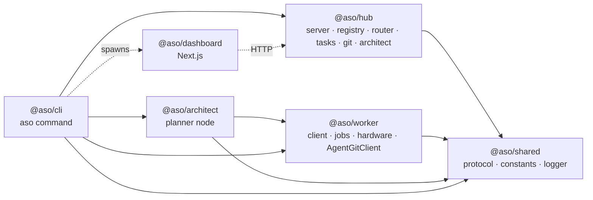

| Package | Key modules | Responsibility |
|---|---|---|
| `@aso/shared` | `agent-tools.ts` | Tool names, descriptions and Zod input schemas, shared by Hub (definitions sent to the model) and worker (validation) |
| | `roles.ts` | `ROLE_POLICIES` (tools + writable globs per role), `writeDenial`, glob matcher |
| | `plan.ts` | `orderPlan`: validates a plan (keys, dependencies, cycles) and orders it |
| | `protocol.ts` | `AgentMessageSchema`, task and hardware schemas, `PROTECTED_FILENAMES`, `TASK_REF_PATTERN` |
| | `hub-address.ts` | `resolveHubUrl` (ws URL), `hubGitUrl` (Git URL from the same host and port) |
| `@aso/hub` | `dependencies.ts` | `DependencyManager` (ownership, allowlist, limits, dedup) and `npmInstaller` |
| | `push/notifier.ts`, `push/workers.ts`, `push/web-push.ts` | `Notifier` (subscriptions, `notableChanges`), `WorkerWatch` (worker machines offline and back) and Web Push delivery (RFC 8291 encryption, VAPID) with `node:crypto` |
| | `deploy.ts` | `Deployer`: runs the operator's deploy command from `deploy.json` after each merge, one at a time per project, in a clean export with a reduced environment |
| | `server.ts` | HTTP API, WebSocket validation pipeline, Git route, liveness and reclaim sweep |
| | `registry.ts` | `NodeRegistry`: connected nodes, heartbeats, the jobs each runs (up to its slots), drain/restart, automatic updates |
| | `routing.ts` | `selectNode()`: a pure, deterministic routing function |
| | `tasks.ts` | `TaskManager`: queue, dispatch, verification, QA, rework, merge, node-loss handling |
| | `git/http-backend.ts` | Git smart-HTTP via a `git http-backend` CGI bridge, with the push policy |
| | `git/hub-repo.ts` | `HubRepository`: verify task commits, merge and add dependencies on main under one lock |
| | `llm/adapter.ts` | `LlmAdapter` interface; `AnthropicApiAdapter` (official SDK, streaming, caching, fallbacks) |
| | `llm/openai-compatible.ts` | `OpenAiCompatibleAdapter`: any Chat Completions API (OpenAI, OpenRouter, Ollama, vLLM…) |
| | `llm/providers.ts` | `Providers`: the model providers (added with a key or address, plus the `.env`'s), their model lists, and the adapter for a `<provider>/<model>` spec |
| | `llm/conversations.ts` | `ConversationManager`: Hub-held conversations, turn checks, budget, concurrency queue |
| | `llm/prompts.ts`, `llm/pricing.ts` | Role system prompts, task prompt (with rework feedback), price table |
| | `plans.ts` | `PlanManager`: plan queue, Architect assignment, validation, approval → tasks |
| | `projects.ts` | `ProjectSet`: finds and creates projects; each has its own repo, tasks, plans, dependencies, push sync, state and transcripts. Hub-wide dispatch and lookup by task/plan id. `create(name, { github })` connects a GitHub repository: checks the token's write access and default branch (`GitHubApi.repoAccess`), then clones it or, when empty, pushes the first commit; nothing is left behind on failure |
| | `state-store.ts` | `StateStore`: saves tasks and plans (per project, `.git/aso/`) and conversations (Hub-wide) and loads them on start |
| `@aso/architect` | `client.ts`, `planner.ts` | Architect node: registers, plans each `PLAN_REQUEST` with read-only tools via the Hub, submits `PLAN_RESULT`. Run by the CLI's hidden `aso architect` command in tmux |
| `@aso/worker` | `client.ts` | Connect, register (slots, running jobs as resume claims), heartbeat, offline outbox, dispatch jobs |
| | `jobs.ts` | `JobRunner`: up to `slots` jobs at once, each in its own checkout; implementation jobs (via a `TaskExecutor`, with `requestDependencies` / `callModel`) and QA runs |
| | `agent/executor.ts` | `LlmTaskExecutor`: the agent loop (model turn via Hub → run tools → repeat until `finish`) |
| | `agent/tools.ts` | `AgentTools`: executes the model's tool calls inside the checkout |
| | `run-command.ts` | Shell-free command runner with process-group timeout |
| | `sandbox.ts` | `CommandRunner`: `DockerSandbox` (a container per job command, default) or `hostRunner` (`--sandbox none`) |
| | `hardware.ts` | `systeminformation` profile and disk write benchmark |
| | `git/agent-git-client.ts` | The only Git interface agents get |
| `@aso/cli` | `index.ts`, `commands/*` | Argument parsing and process orchestration (native or Docker) |
| `@aso/dashboard` | `app/**`, `components/*` | The console: home, task (live transcript), plan (approve/reject), new plan, worker (a model per desk, grouped by provider), worker machines, model providers (add with a key, remove, prices), sign-in, notifications (`public/sw.js`). Client pages poll the Hub through `app/api/hub/[...path]` |
| | `lib/view.ts` | Pure view logic: home grouping, badges, transcript → terminal lines |
| | `lib/auth.ts`, `lib/hub-routes.ts`, `proxy.ts` | Session cookie and Basic auth, browser-origin redirects, the allowlist of Hub endpoints the browser may reach |

## 4. Communication protocol

### Envelope

Every WebSocket frame is one JSON object:

```json
{
  "id": "uuid",
  "from": "node id, or \"hub\"",
  "timestamp": "ISO-8601",
  "type": "TASK_ASSIGNMENT",
  "payload": { }
}
```

`AgentMessageSchema` is a Zod discriminated union on `type`. Every object is strict, so unknown
keys are rejected.

### Message types

| Type | Direction | Phase | Purpose |
|---|---|---|---|
| `NODE_REGISTRATION` | node → hub | 1 | First message. Workers send their hardware profile, `slots` (jobs at once; absent means 1) and `running`, the jobs they are still running after a reconnect (older workers send one `resume` claim instead) |
| `REGISTRATION_ACK` | hub → node | 1 | Registration accepted |
| `NODE_HEARTBEAT` | node → hub | 2 | Every 15 s: free RAM, CPU load, Docker availability |
| `TASK_ASSIGNMENT` | hub → node | 2 | A `TaskSpec` with its `project` (the worker checks out `/git/<project>.git`), plus `rework` (round, reason, failures, test output) when the task comes back |
| `STATUS_UPDATE` | node → hub | 2 | `accepted`, `in_progress`, `waiting_*`, `completed` (with commit and any `screenshotTargets`), `failed`, `idle` |
| `TEST_EXECUTION` | hub → node | 3 | QA: test an exact commit with `setup` steps and a `command` argv; carries the `project` and any `screenshotTargets` |
| `FEEDBACK_LOOP` | node → hub | 3 | QA verdict: `pass` (with the screenshots the project's script saved, if any), or `fail` with at least one failure and the output tail |
| `FILE_OPERATION` | node → hub | 5 | Audit trail of agent file edits (sent by the agent loop) |
| `DEPENDENCY_REQUEST` | node → hub | 4 | Ask the Hub for a package.json change: `add_dependencies` or `set_scripts` (idempotent by `requestId`) |
| `DEPENDENCY_RESPONSE` | hub → node | 4 | `installed` (with the main commit) or `rejected` |
| `PROMPT_EXECUTION` | node → hub | 5 | One agent turn for a `taskId` (worker) or `planId` (Architect): `conversationId`, `turn`, and the results of the previous turn's tool calls. Nothing else: the Hub holds the conversation |
| `PROMPT_RESULT` | hub → node | 5 | The model's visible text and tool calls for that turn, plus usage/cost; or an error marked retryable or not |
| `PLAN_REQUEST` | hub → architect | 6 | Plan this requirement (`planId`, `requirement`); carries the `project` |
| `PLAN_RESULT` | architect → hub | 6 | `proposed` (summary + planned tasks with plan-local keys and `dependsOn`) or `failed` |
| `NODE_CONTROL` | hub → worker | 1 | `restart`: exit so systemd starts the worker again. `update` (with `version`): install the package the Hub serves, then exit the same way. Sent only to workers that registered with `supervisor: "systemd"` (their pid is the unit's `SYSTEMD_EXEC_PID`), `update` only to those that also registered `updates: "package"`, and only once idle |
| `UPDATE_FAILED` | worker → hub | 1 | The update could not be installed (`version`, `reason`); the worker carries on with its build |
| `PROTOCOL_ERROR` | hub → node | 1 | Why a message was rejected, with the offending message id |

### Validation pipeline (Hub)

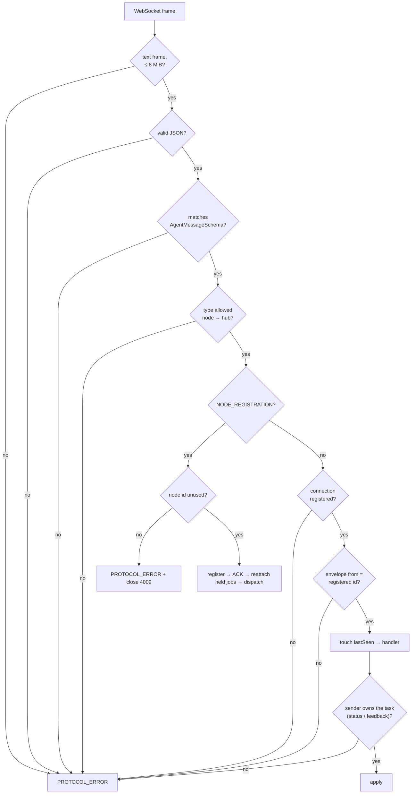

Schema-level rules worth knowing:

| Field | Rule | Why |
|---|---|---|
| `taskId` | `^[a-z0-9][a-z0-9-]{0,63}$` | Used directly as the branch name `task/<id>` |
| Repo paths | relative; no `..`, `.git`, `~`, `\` | Cannot escape the checkout |
| `DEPENDENCY_REQUEST.name` / `version` | npm name grammar; semver range characters only | No git URLs, `file:` specs or shell metacharacters |
| `STATUS_UPDATE` | `taskId` required unless `idle`; `commit` required for `completed` | Every completion is traceable to a commit |
| `FEEDBACK_LOOP` (`fail`) | `failures` must be non-empty | Feedback is actionable |
| `PROMPT_EXECUTION` | only `toolResults` (id, content, isError) | Nodes can't send a system prompt or forge model messages |

## 5. Node lifecycle

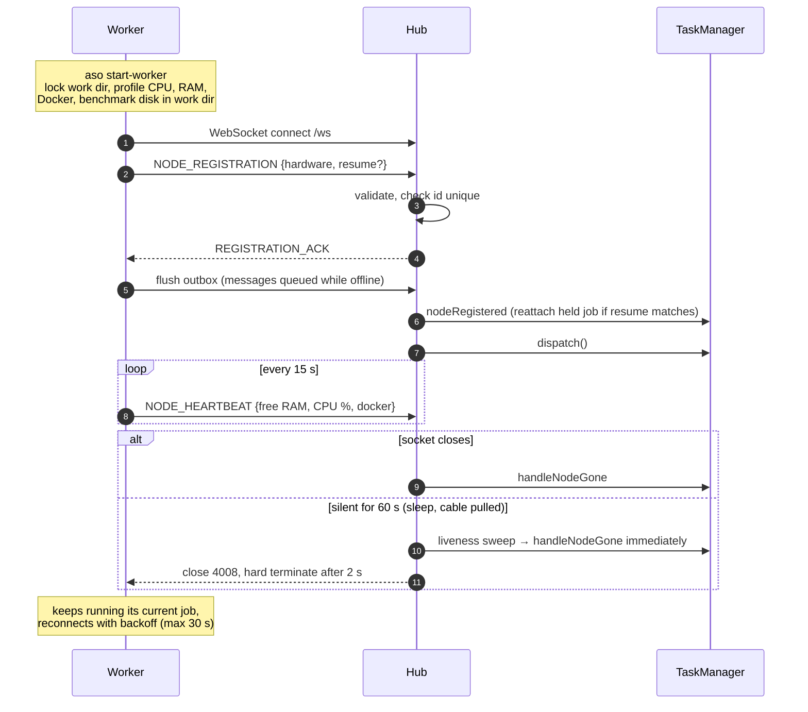

### When a node drops off the network

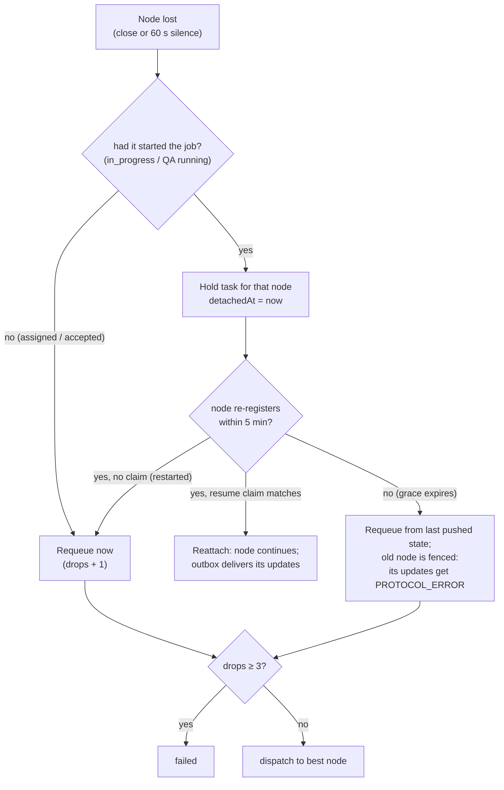

Holding a started job is cheap. LLM access is centralized, so a disconnected worker can't make
progress anyway; it is effectively paused. A short network blip therefore costs nothing.

**A resume claim covers finished jobs too.** A job can end while the node is cut off: tests
finish, or an agent's commit is pushed just before a Hub restart. Its result then waits in the
worker's outbox, marked as the job's final message (`Send`'s `final`). On re-registration
the worker claims those jobs as well as running ones, so the Hub reattaches the job and the
held result is accepted, instead of requeuing the job and rejecting the result.

### When the Hub restarts

Tasks, plans and agent conversations are saved to disk, so a Hub restart looks to the swarm
like every node dropping off at once and coming back.

**Where.**
- **Per project:** tasks, plans and transcripts go in `<project>/.git/aso/`. Inside `.git` the
  state stays with the project it describes, is covered by the Docker bind mount, and is never
  committed or served. The Git endpoint only answers smart-HTTP paths, so clones don't include
  it.
- **Hub-wide:** agent conversations go in `<projects root>/.aso/`. That folder starts with a
  dot, so it is never taken for a project.
- **In memory only:** `HubOptions.stateDir: null`.

| File | Content | Written |
|---|---|---|
| `state.json` | `{version, savedAt, tasks, plans}` | 200 ms after a change, batched; on shutdown |
| `conversations/<id>.json` | Messages, next turn, pending tool calls, last answer | After every model turn; deleted with the conversation |

Writes go to a temp file that is renamed into place, one at a time, so a crash leaves the
previous version intact. A file the Hub can't read (bad JSON, unknown `version`) is renamed
to `state.json.unreadable-<time>`, never deleted, and the Hub starts empty.

**On start**, before any node connects, saved work is put back like this:

| Saved state | After the restart |
|---|---|
| `in_progress`, or `testing` with tests started | Held for its node for the grace period (`detachedAt = now`); the node reclaims it with its resume claim |
| `assigned`, or `testing` not started | Back to `pending` / `awaiting_qa`; not counted as a drop |
| `verifying` | Verified again |
| `merging` | Merged again; a commit already on `main` merges as "already up to date" |
| `awaiting_review` | Unchanged; the next pull request check carries on (opens it if it never was) |
| Plan `planning` | Back to `pending` for the next Architect |
| Anything else | Unchanged |

The state is saved **before** the Hub closes the nodes' connections on shutdown, so those
disconnects, which are the Hub's doing, never count against a task.

**Agents continue mid-task.** Because the Hub holds the conversation (see
[section 10](#10-llm-gateway-and-agent-loop)), restoring it is enough: the worker reconnects,
re-sends the turn it was waiting for (answered from the saved last answer if the model had
already replied), and the next turn goes to the model with the full history. Conversations
whose task moved on are deleted on load.

**Node ids** are `<hostname>-<random>` for workers and `architect-<uuid>` for the Architect.
They are fixed for the life of the process, so a reconnect reuses the same id.

**Stale closes.** Unregistering is tied to the connection, so a late `close` event from an old
socket can't evict a node that has already reconnected. The Architect has no load metrics; it
keeps itself alive by sending `STATUS_UPDATE {state: "idle"}` every 15 s.

## 6. Hardware-aware routing

### Inputs

| Metric | Source | Refreshed |
|---|---|---|
| Logical cores, total RAM, disks | `systeminformation` at boot | Registration |
| OS name and version | `/etc/os-release` (not `systeminformation.osInfo()`, which runs `hostname -f` synchronously and blocks for minutes when the machine's own name does not resolve) | Registration |
| Disk write MB/s | 64 MiB sequential write + `fsync` in the worker's work dir | Registration |
| Free RAM, CPU load % | `systeminformation` | Every heartbeat (15 s) |
| Docker daemon reachable (and its version) | `docker version`, so it follows the Docker context and `DOCKER_HOST` like the sandbox (rootless Docker and Docker Desktop are not on `/var/run/docker.sock`) | Registration (checked before the hardware scan, which can block the event loop and make the check's timeout discard Docker's answer) and every heartbeat. The worker logs why Docker did not answer (CLI missing, no answer in 10 s, or the daemon's error) at startup and whenever it changes; the Hub updates the recorded profile and logs `Docker now available` / `no longer available` when a heartbeat disagrees with it |

Before anything else the worker takes `<workDir>/worker.lock` (`lockWorkDir` in
`packages/worker/src/work-dir-lock.ts`): its pid, boot id and a token, created with `O_EXCL`.
Two workers sharing a directory would overwrite each other's checkouts, so a second one exits
with an error while the holder's pid is alive in the same boot. A lock whose process is gone,
from another boot, or unreadable is taken over; release on stop or process exit removes it only
if its token is still ours.

The disk benchmark runs in the **work directory**, not `/tmp`. On CachyOS and similar
distributions `/tmp` is tmpfs and would report RAM speed.

### Algorithm

`selectNode(request, nodes, policies)` in `packages/hub/src/routing.ts` is a pure function.
QA runs use the same router with `role: "qa"` and the configured QA kind (default
`unit_test`). The role never filters nodes: the Architect assigns roles to tasks, and any worker
runs any role. (Workers built before this sent the roles they accepted; the Hub ignores them.)
QA passes `avoid: <implementer>`: the implementer is dropped from the eligible nodes when any
other node is eligible, and gets the run only when it is the sole eligible node, so QA never
waits for independence.

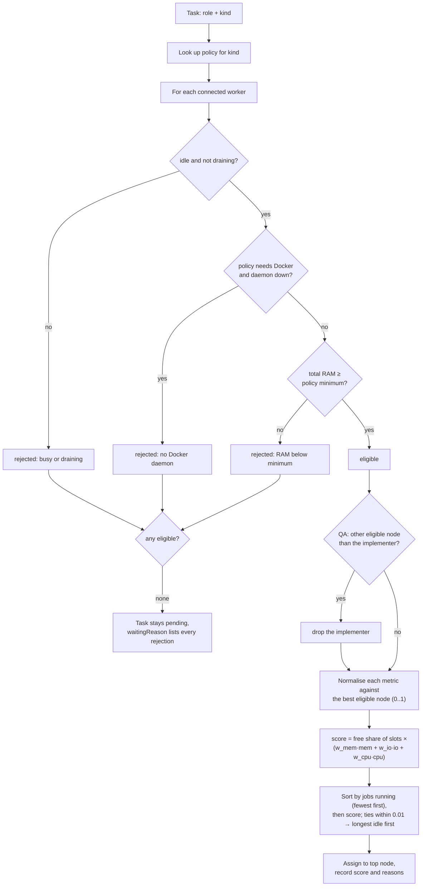

The metrics are:

- **Memory:** free RAM from the latest heartbeat, falling back to the registration value.
- **I/O:** the measured disk write speed.
- **CPU:** effective cores, calculated as logical cores × (1 − CPU load).

**Fewest jobs first.** The sort puts the number of jobs a node runs ahead of its score, so a
job goes to an idle machine over a stronger busy one. Parallel tasks then run on parallel
machines: agents mostly wait for the model, and builds and tests on one machine compete for
its CPU. The score still decides among equally busy nodes, and the reasons name the busier
nodes passed over ("over avalon-…, which is busier"). This came from the first real run, where
a 12-core worker with a job running outscored an idle 8-core one, so one machine implemented
every task.

### Policies

| Kind | Hard constraints | w_mem | w_io | w_cpu |
|---|---|---|---|---|
| `feature` | — | 0.2 | 0.2 | 0.6 |
| `unit_test` | — | 0.3 | 0.2 | 0.5 |
| `e2e_test` | total RAM ≥ 4 GiB | 0.7 | 0.1 | 0.2 |
| `db_migration` | — | 0.1 | 0.8 | 0.1 |
| `container_build` | Docker daemon running | 0.3 | 0.3 | 0.4 |

Pass `startHub({ policies })` to override them. Scores are relative to the current fleet, so
adding a faster machine changes which node is "best" without retuning anything.

## 7. Task lifecycle

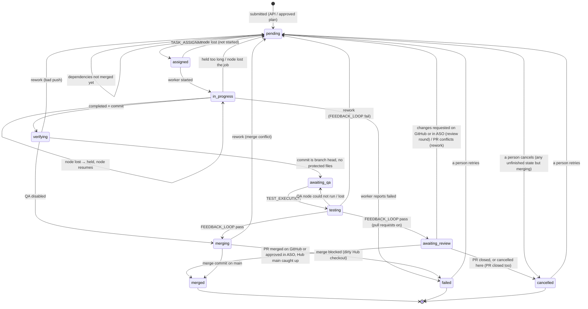

| Limit | Default | When exceeded |
|---|---|---|
| Node losses per task (`maxDrops`) | 3 | `failed` |
| Rework rounds (`maxReworkRounds`) | 3 | `failed` |
| QA infrastructure failures (`maxQaAttempts`) | 3 | `failed` |
| Grace period for started jobs (`reclaimGraceMs`) | 5 min | requeue |

- **Queue order.** The queue is FIFO. `dispatch()` runs whenever something could unblock a task.
- **Dependencies.** A task with `dependsOn` stays `pending` until every dependency is `merged`
  (`waitingReason: waiting for … to be merged`). If a dependency fails, its dependants stay
  pending as `blocked`. Dependants branch from `main`, so they start with the dependencies'
  code.
- **Job slots.** A worker registers with `slots` (`--slots`, or `defaultSlots`: one per 2
  threads and 6 GiB, at most 4, 1 without the Docker sandbox). The registry keeps the set of
  jobs each node runs; a job is added at assignment and removed when its part ends
  (implementation completed or failed, or QA verdict reported). A node is busy once the set
  fills its slots, and the router scales each node's score by its free share of slots, so
  work spreads across machines before doubling up. On the worker, `JobRunner` gives each job a
  slot and a checkout of its own (`<workDir>/<project>` for slot 1, `<project>.N` after it; dots
  never appear in project names), so the sandbox mounts only that job's checkout. A worker
  that reconnects reports all its `running` jobs and gets each one back. The Architect has one
  slot.
- **Ownership.** Status updates and verdicts are accepted only from the node that currently
  owns that stage of the task.
- **History.** Every task keeps an event history (last 50 entries), shown by
  `GET /api/tasks/:id` and the dashboard.
- **Cancel.** `POST /api/tasks/:id/cancel` works in every state except `merged`, `failed`,
  `cancelled` and `merging`. It releases the task's nodes. A node still working on it is
  fenced like a node that lost its job: its status updates, model calls and QA verdicts are
  refused, so the agent stops at its next model turn. Dependants are `blocked`, as for a
  failure.
- **Drain and restart.** `POST /api/nodes/:id/drain` sets `draining` on the registry entry;
  the router skips draining nodes, and the current job carries on. `/resume` clears it.
  `/restart` drains the worker and sets `restart: "pending"`; when the registry releases the
  worker's job (or at once if it is idle) it sends `NODE_CONTROL restart` and marks it
  `"sent"`. The worker waits for its job runner to empty, stops, and exits 0; the unit's
  `Restart=always` starts it again on the installed build, as a new node. State lives on the
  connection, so a worker that reconnects comes back undrained. `nodeActions` in
  `registry.ts` is the one place these rules live: the API refuses what it disallows (409 with
  its `why`), and `/api/nodes` sends it as `actions`, which the console turns into buttons.
- **Automatic updates.** When a worker registers on another build than the package the Hub
  serves (after the jobs it still runs are handed back), `requestUpdate` treats it like a
  restart with `updateTo` set: drained, then `NODE_CONTROL update` once idle. Only workers that
  registered `updates: "package"` and a `supervisor` qualify: the CLI sets `onUpdate` for a
  package install run by systemd, which calls the same `installHubPackage` as `aso update`
  (download, SHA-256 check, `npm install --global`, run asynchronously so heartbeats go on)
  and then exits. A failed install sends `UPDATE_FAILED` and the worker keeps running; the Hub
  undrains it. Attempts are kept per hostname and build, since a worker comes back under a new
  node id: after a reported failure, or after `MAX_UPDATE_ATTEMPTS` (2) updates that brought it
  back on its old build, the Hub stops asking and shows `updateError`. A registration on the
  Hub's build clears the record. `ASO_AUTO_UPDATE=0` turns it off.
- **Retry.** `POST /api/tasks/:id/retry` requeues a `failed` or `cancelled` task with fresh
  limits: rework rounds, node drops, QA attempts and budget. The budget counts from the retry
  (`budgetBaseUsd`), while `llm.costUsd` keeps the total. The branch keeps the previous
  attempt, and the agent gets a `rework` note saying why it is running again.

### Transcripts

Every task and plan has a transcript: the agent's text, each tool call (long string inputs
trimmed to 2,000 characters), each tool result, Hub events and QA verdicts with the runner's
output. Long text keeps its first 1,500 and last 6,500 characters, because the end of a test
run is usually what matters. The `ConversationManager` records the agent side as turns pass
through it. `TaskManager` and `PlanManager` record events and verdicts.

- **Storage.** Kept in memory (last 1,000 entries per transcript) and appended to
  `<stateDir>/transcripts/<task|plan>-<id>.jsonl`. They survive restarts and outlive the
  conversation itself.
- **Reading.** `GET /api/tasks/:id/transcript?after=<seq>` (and `/api/plans/:id/transcript`)
  returns `{entries, last}`. Entries have increasing `seq` numbers, so the console polls for
  only what's new.

### Agent names

Workers send the job slot with `in_progress` status updates (`slot`, from 1). The task manager
appends `{job, host, slot, nodeId, at}` to the task's `crew` when an agent starts a job and
isn't already the latest one doing it, so repeated updates add nothing and a rework on another
desk adds an entry. `agentName()` in `@aso/shared` gives `<host> #<slot>`. `/api/nodes` adds
`jobs: [{taskId, job, slot}]` to each node, with the desk taken from the crew, so a UI seats a
running job at the right desk.

### The API contract

The HTTP API is described once, as Zod schemas in `@aso/shared` (`api.ts`): request bodies
(`CreateTaskBodySchema`...) and answers (`TaskSchema`, `PlanSchema`, `NodeSchema`...), plus the
task and plan state enums the Hub's own types come from.

- **Requests** are parsed with those schemas in `server.ts` before a manager sees them. A
  manager's own checks still run, and come first where their status matters more: a reply to
  a plan that takes none is a 409, whatever the body.
- **The OpenAPI 3.1 document** (`hub/src/api/openapi.ts`) is built from a table of every route
  (`API_OPERATIONS`) and `z.toJSONSchema` of the schemas. It is served at `/api/openapi.json`
  and written to `docs/openapi.json` by `npm run openapi`.
- **Drift is caught three ways.** A test compares the Hub's Hono routes with the table. A test
  parses real answers with the schemas and fails on any field they don't name. And
  `api/contract.ts` fails the build when `TaskRecord`, `PlanRecord` or a node view gains a
  field the schemas lack. Another test keeps `docs/openapi.json` equal to the generated
  document.
- **Answers are open objects:** clients must ignore unknown fields, so adding one is not a
  breaking change.

### The console

The console (`packages/dashboard`, Next.js App Router, standalone server on :7421) is a
phone-first client of the API above.

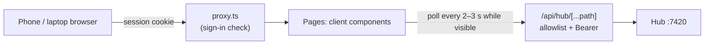

- **Polling.** Lists poll every 3 s and transcripts every 2 s, only while the page is visible,
  so a phone in a pocket costs nothing. Transcripts fetch with `?after=<seq>`, so each poll
  carries only new lines. Server-sent events would be lighter but add a long-lived
  connection per phone through the proxy; polling was enough for v1.
- **The token stays on the server.** Pages call `/api/hub/...`. The route handler checks the
  path against `lib/hub-routes.ts` (task/plan reads and transcripts, cancel/retry,
  create/approve/reject plans, drain/resume/restart a worker; no raw task submission or sync) and adds the
  Bearer token. A cross-site `Origin` on a POST is refused, since browsers re-send Basic-auth
  credentials across sites.
- **Redirects use the browser's address.** Next.js builds `request.url` from the address it
  binds to (`localhost`), so a redirect built from it would send a phone on the LAN to
  `localhost`, and the session cookie would be lost. `browserOrigin()` uses the `Host`
  header, or `X-Forwarded-Host`/`-Proto` behind an HTTPS proxy.
- **Logic stays out of components.** `lib/view.ts` decides what needs attention, the badges
  and how a transcript entry reads as a terminal line. It is unit-tested with `node --test`
  like the rest of the repo.

### Push notifications

```mermaid
sequenceDiagram
  participant C as Console (phone)
  participant SW as Service worker (sw.js)
  participant H as Hub (Notifier)
  participant PS as Push service (FCM / Apple / Mozilla)
  C->>H: GET /api/push → VAPID public key
  C->>PS: pushManager.subscribe(key)
  C->>H: POST /api/push/subscriptions (endpoint, p256dh, auth)
  Note over H: task or plan state changes
  H->>PS: POST endpoint (aes128gcm body, VAPID JWT)
  PS->>SW: push event
  SW->>C: showNotification; tap opens /plans/:id or /tasks/:id
```

- **What notifies.** `ProjectSet` calls back on every task or plan change. `notableChanges()`
  (pure, `hub/src/push/changes.ts`) compares each record's state with the last one seen and
  picks the transitions worth interrupting someone for:
  - a plan becomes `proposed`, or `awaiting_input` (the Architect has questions)
  - a plan or task becomes `failed`
  - a task becomes `merged`, either as the last task of its plan ("plan done") or as a task
    that isn't part of any plan
- **Worker machines going offline.** `WorkerWatch` (`hub/src/push/workers.ts`) follows
  workers by hostname, since a worker gets a new node id on every connection. When a machine's
  last worker has been gone for 10 minutes (`WORKER_OFFLINE_ALERT_MS`, long enough to ride out
  restarts, self-updates and short sleeps), it sends "Worker <host> is offline" once; when a
  worker from that host registers again, "Worker <host> is back" replaces it (same tag). The
  sweep that times out stale nodes runs the check. Known hosts are kept in `workers.json`
  beside `push.json`, so a machine that never reconnects after a Hub restart is still reported,
  counted from the restart. A host gone 14 days (`WORKER_FORGET_MS`) is forgotten.
- **No replays.** A record seen for the first time (Hub start, a restored task) never notifies,
  so restarts don't repeat old news.
- **No push library.** `hub/src/push/web-push.ts` implements RFC 8291 payload encryption
  (aes128gcm) and RFC 8292 VAPID with `node:crypto`. It is tested against the RFC's example
  vector and by decrypting as a browser would.
- **Storage.** The key pair and subscriptions are Hub-wide, in `push.json` next to the
  conversations (`<root>/.aso/`, mode 0600). An unreadable file is moved aside and new keys
  are made. Subscriptions the push service answers `404`/`410` for are dropped; other
  failures are logged and kept.
- **Console side.** `public/sw.js` only shows notifications and opens console paths (it
  caches nothing). It is public, like the icons, and served `no-store` so phones pick up
  changes. `lib/push.ts` decides whether a device can subscribe (https, iOS home-screen
  install, permission) and turns browser errors into advice.

## 8. Git flow

### End to end

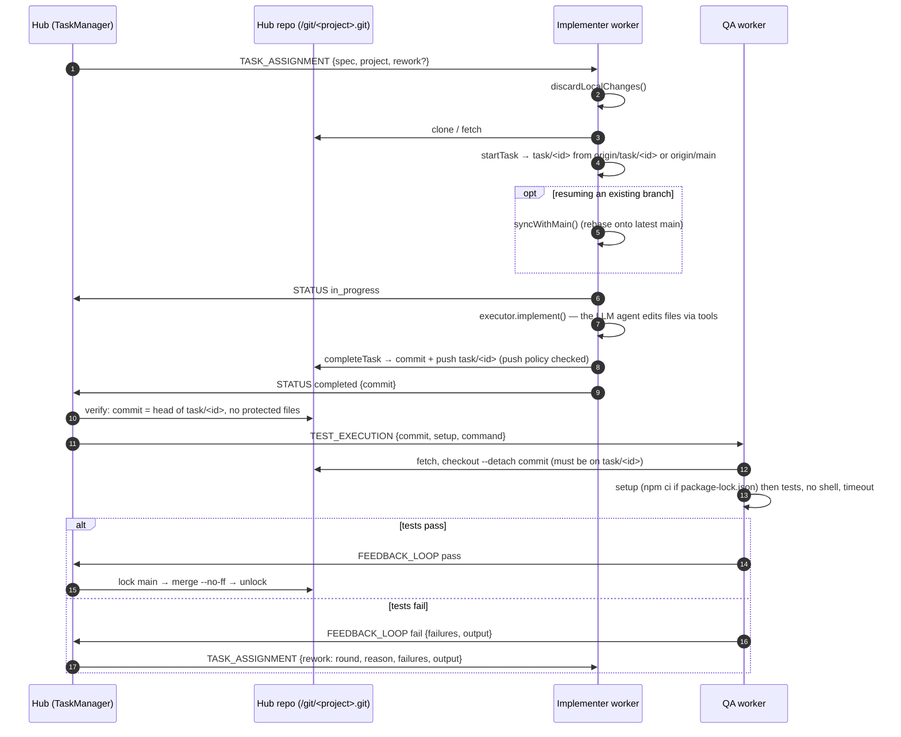

### The Hub's Git endpoint

`/git/<project>.git` is Git smart-HTTP, implemented as a CGI bridge to `git http-backend`
running against that project's directory. An unknown project returns 404, and the project
name is restricted to `[a-z0-9_-]`, so it can't address anything else:

1. Only `info/refs`, `HEAD`, `git-upload-pack` and `git-receive-pack` are routed. Everything
   else returns 404, so the endpoint never serves arbitrary files.
2. For pushes, the Hub parses the ref-update commands at the start of the `git-receive-pack`
   request body and applies the **push policy** before git sees the request:

| Allowed | Refused (HTTP 403) |
|---|---|
| Create or update `refs/heads/task/<id>` | `main` or any other branch, tags, deletions, signed pushes |

Pushes land as branch refs in the Hub repo without touching its checked-out `main`.

### Verification and merge (`HubRepository`)

**Before QA** the Hub re-checks the worker's claim:

- `task/<id>` exists and its head equals the reported commit.
- There are changes relative to `main`.
- No protected file changed. This is the same `PROTECTED_FILENAMES` list the worker enforces,
  so a buggy or modified worker can't sneak lockfile changes past QA.
- Every changed file is within the task role's writable scope (`ROLE_POLICIES`). For example,
  a QA branch that edits `src/` is sent back.

**Merging** the tested commit, not whatever the branch points to now, runs under the `main`
lock it shares with dependency installs:

| Situation | Result |
|---|---|
| Clean checkout on `main` | `git merge --no-ff` as "ASO Hub" → `merged` |
| Conflict with `main` | `merge --abort`, checkout left clean → rework round asking the worker to rebase |
| Checkout dirty or on another branch | `failed: merge blocked` (an operator problem, not a code problem) |

**After a merge** the task's branch is deleted: its commits stay reachable from `main` through
the merge commit, so only the name goes. The Hub's own merge deletes `task/<id>` inside the same
`main` lock; a pull request merged on GitHub (or from the console) deletes it from the
`onMerged` hook, also under the lock. Either way only a branch still pointing at the merged
commit is deleted, and failed or cancelled tasks keep theirs (their unfinished work is there).
When a project opens, `pruneMergedTaskBranches` removes leftovers: branches of merged tasks, and
branches no task owns whose tip is already in `main`. The GitHub copies of pull-request
branches are GitHub's to delete: turn on *Automatically delete head branches* in the
repository's settings.

**Shutting down** waits for Git work already under way: a push to `origin` in progress finishes
(`GitSync.stop()`), and so does anything queued on the `main` lock (a merge, a branch deletion),
so a restart never cuts one off halfway.

### Worker side: `AgentGitClient`

Agents cannot run `git`. The worker wraps `simple-git`.

**Dependencies.** Agents may not install packages, so before the agent starts, the job runner
runs `npm ci` when the checkout has a `package-lock.json` that its `node_modules` was not
installed from (`installDependencies`). A stamp in `node_modules` holds the lockfile's
SHA-256, so a reused slot reinstalls only after `main` gained dependencies. The same check runs
after a dependency request. A failed install is reported and the agent may run `npm ci`
itself. `cloneOrOpen` adds `node_modules/` to the checkout's `.git/info/exclude`, so
`git add -A` never commits it, whatever the project's `.gitignore` says.

| Method | Behaviour |
|---|---|
| `cloneOrOpen(dir, url)` | Use an existing checkout (repointing `origin` if the Hub moved), or clone |
| `discardLocalChanges()` | Abort any rebase or merge, `reset --hard`, `clean -fd` (keeps ignored files such as `node_modules`). Runs before every job |
| `startTask(id)` | Requires a clean tree; checks out `task/<id>` from `origin/task/<id>` (`resumed: true`) or `origin/main` |
| `completeTask(msg)` | Rejects protected files (uncommitted edits and commits since `origin/main`), stages, commits as the agent identity, pushes with `--force-with-lease` |
| `syncWithMain()` | Stashes edits, rebases onto `origin/main`, restores edits; conflicts abort cleanly (see below). Used mid-job, after a dependency change |
| `syncForRework()` | At the start of a resumed job: `syncWithMain()`, or, if the rebase conflicts, `replayOnMain()`: `task/<id>` restarts from `origin/main` and the task's diff (merge base → old head) is re-applied with `git apply --3way`. Clean hunks land, conflicting files keep `<<<<<<<`/`>>>>>>>` markers, the index is reset so everything is uncommitted. Returns the conflicted files |
| `unresolvedConflicts()` | Changed files that still contain conflict markers (`hasConflictMarkers`); the executor refuses `finish` while any are left |
| `checkoutCommit(id, sha)` | QA: fetch, ensure `sha` is on `origin/task/<id>`, detached checkout |

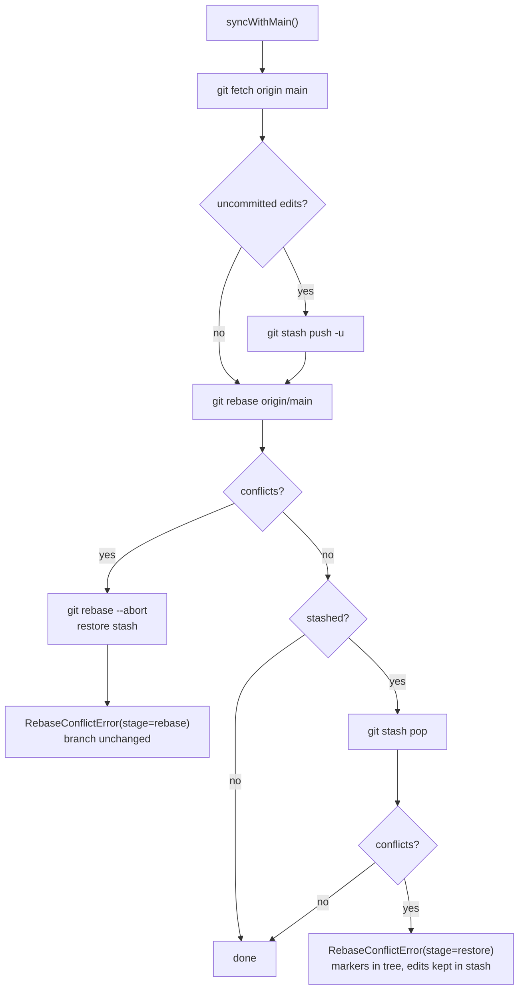

**Conflicts are the agent's to resolve.** Agents have no git, so the worker does the git part.
A resumed job whose branch conflicts with `main` (typically a pull request that conflicts after
another one merged) gets the branch replayed onto `main` with markers in the conflicting files,
instead of failing. The worker sends those files as `conflicts` on its `in_progress`
STATUS_UPDATE; the Hub keeps them on the task (`task.conflicts`, cleared when the work is handed
in or sent back) and the task prompt gets a *Merge conflicts to resolve* section listing them.
`finish` is refused, with the files named, until no marker is left.

simple-git does not reject when git exits non-zero with an empty stderr. That happens, for
example, with `rev-parse --verify --quiet` and with a conflicting `stash pop`. The client and
`HubRepository` therefore check command output and repository state directly instead of
relying on exceptions.

### The acceptance check (`AcceptanceChecker`)

After QA passes, `TaskManager.approved()` runs the check when the Hub has one and the task has
acceptance criteria; the task shows `verifying`, with `acceptance.result: "checking"` (a Hub
restart runs the check again). `llm/acceptance.ts` sends the Architect's model the task, its
numbered criteria, the agent's summary (labelled a claim) and the diff against the task's base
(cut at 120,000 characters; then it's told to mark what it can't see `unclear`), with one tool,
`report_acceptance`: a verdict per criterion (`met`, `unmet`, `unclear`) and a summary.

- **Unmet:** a rework round whose reason lists each unmet criterion and what's missing.
- **Met (unclear doesn't block):** on to review or merge; `acceptanceNote` adds the verdict to
  the pull request.
- **Undecided:** no model, a model error, no diff, or an answer that skips a criterion; the
  work goes on, noted on the task and in the pull request.

A verdict for a commit that's no longer the task's (a newer push, a cancel) is dropped. The
check's tokens count toward the task's spend. Tried on the real history of aso-ui #99: it judged
both of a local model's incomplete rounds unmet (0 of 6 criteria) and the finished round met.

### QA runs

The worker runs `setup` steps, then `command`, each through `runCommand`:

- **No shell.** Commands come straight from the Hub's argv.
- **Isolation.** Each command runs in its own process group, so a timeout kills the whole tree
  (npm, then vitest, then its workers).
- **Non-interactive.** `CI=1` keeps test runners out of watch mode.
- **Output.** The last 50 KB of output is attached to a failing `FEEDBACK_LOOP`.

The QA worker distinguishes two kinds of failure:

- **Infrastructure problems** (checkout failed, program not found): `STATUS_UPDATE failed`.
  The Hub retries QA, possibly on another node.
- **Code problems** (non-zero exit, timeout): `FEEDBACK_LOOP fail`, which starts a rework
  round.

**Screenshots.** After the tests pass, if the developer listed views (below) and the checkout's `package.json` has a `screenshots`
script, the worker runs `npm run screenshots` with `ASO_SCREENSHOT_DIR` pointing at an empty
`.aso-screenshots/` folder in the QA checkout (inside the job sandbox's mount, removed after).
`collectScreenshots` takes the images at the top of that folder in name order. It reads each
type from the bytes and keeps at most 12 images, each up to 2 MB and 4 MB together, so the
verdict stays well under the frame limit. They ride on `FEEDBACK_LOOP pass`. A failing or
slow (5 min) script is only noted in the summary: it never fails QA.

What to shoot comes from the developer agent. `finish` takes an optional `screenshots` list of
views (`ScreenshotTarget`: `name`, `path`, optional `theme`, `width`, `height`, `selector`,
`state`), which rides on `STATUS_UPDATE completed` as `screenshotTargets`. The Hub keeps it on the
task, replacing it at each finish, because a rework may change something else, and sends it with
`TEST_EXECUTION`. The worker passes it to the script as JSON in `ASO_SCREENSHOT_TARGETS`. Without a
list the worker doesn't run the script: the change shows nowhere in the UI, and the script's
default views would only repeat the same unrelated pages on every pull request. Listed views without a
saved `<name>.png` are named in the QA summary (`missingViews`), and the script's output goes to the
worker's log. The project's script decides
how to start the app and show each view; the schema keeps names plain and paths app-relative.

The Hub keeps one set per task in `<stateDir>/screenshots/<taskId>/` (`Screenshots`), and the
task record lists them (`screenshots: { commit, at, files }`). A new passing run replaces the set,
and one without screenshots removes it, so a reviewer never sees an older commit's images.
`GET /api/tasks/{id}/screenshots/{name}` serves them with the recorded image type, `nosniff`
and a `default-src 'none'` CSP. The console shows them in the task's **Screenshots** tab. The
pull request body lists them and, with `--console-url`, links to the task's page.

### Pushing to origin

`GitSync` (`git/sync.ts`) pushes `main` to the target repository's `origin` after each merge.

- **Coalesced pushes.** A burst of merges becomes one push.
- **Shared lock.** Pushes share the main lock with merges and dependency installs.
- **Following origin.** Merges made outside ASO (a pull request merged by hand, a push) reach
  `main` through `ProjectSet.follow`: `GitSync.catchUp` every `FOLLOW_MS` (2 min), and before
  `POST /api/plans` and plan approval (waiting at most `FOLLOW_WAIT_MS`, 15 s), since the
  Architect reads `main` and tasks branch from it. A `main` that moved counts as a merge
  (`onMerged`: deploys). One pass at a time per project; a lasting failure is logged once.

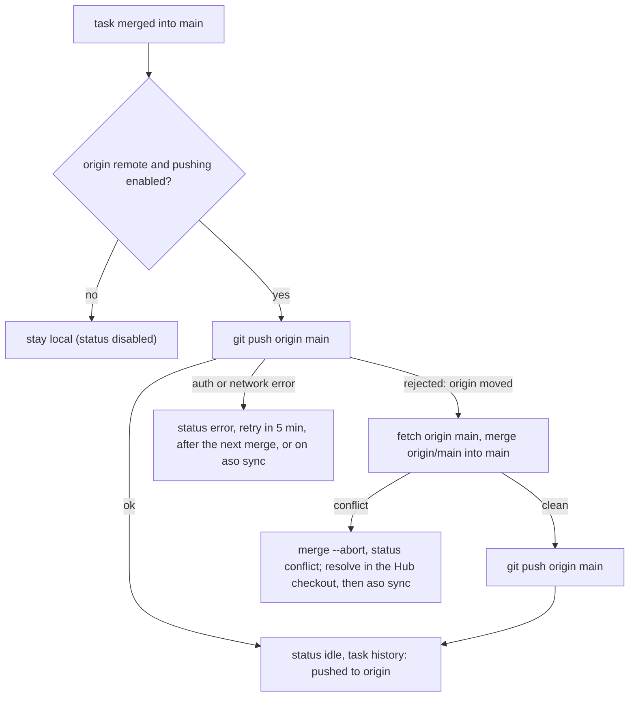

**Credentials:**

- **Native Hub:** uses the user's normal git credentials (SSH agent, credential helper).
- **`ASO_GIT_TOKEN`:** for HTTPS remotes, especially from Docker. It's sent as
  `http.<origin>/.extraHeader` (Basic, `x-access-token:<token>`), scoped to the remote's host,
  per command, and never stored.
- **No prompts:** the Hub sets `GIT_TERMINAL_PROMPT=0`, so a missing credential fails fast
  instead of hanging.
- **Clean URLs:** remote URLs are shown with userinfo stripped.

### Deploying after a merge

`Deployer` (`hub/src/deploy.ts`) runs the operator's deploy command for a project after each
merge into its `main` (`TaskManager.onMerged`, called once the Hub's `main` has the merge, also
for pull requests merged on GitHub, and `ProjectSet.follow` when `main` caught up with other
commits on `origin`), and on `POST /api/projects/{id}/deploy`.

- **Each commit once.** A merge can be reported twice (by its task and by catching up), so an
  automatic deploy skips the commit last deployed successfully; `POST .../deploy` forces one.
- **Restart-safe.** That commit per project is saved in `deployed.json` beside `deploy.json`.
  On start the Hub requests a deploy of every project, which deploys only those whose `main`
  isn't live: merged while the Hub was down, cut off by a restart, or failed last time.

- **Configuration outside the repository.** Commands live in `<root>/.aso/deploy.json`, beside
  the other Hub-wide state, not in the project: agents change the repository, and a command from
  it would run on the Hub host. The file is re-read on every deploy. An invalid or unreadable
  one keeps the last good commands in memory and fails the deploys of those projects with the
  reason; projects without a command never hear of it.
- **Clean input.** `git archive` of the merged commit into `<root>/.aso/deploy/<id>/`, replaced
  each time, so nothing left by an earlier deploy or the Hub's checkout leaks in.
- **One at a time, coalesced.** A merge during a deploy marks the project to deploy again; the
  next run takes `main` as it is then, so a burst of merges is one more deploy.
- **Reduced environment.** `sh -c` in its own process group, with an allowlist of the Hub's
  environment (`PASSED_ENV`) plus the entry's `env` and `ASO_DEPLOY_*`. The GitHub and Anthropic
  tokens stay with the Hub. On timeout the whole group gets SIGTERM, then SIGKILL.
- **Hub in a container.** `aso start-hub --docker` sets `ASO_DEPLOY_RUNNER=host`. The Hub
  still exports and reports, but hands each command to a `HostDeployQueue` instead of running
  it: the `aso start-hub` process on the host (`cli/src/deploy-runner.ts`, next to the
  Architect) polls `GET /api/deploys/next` every 3 s, runs the command in the same export
  (the projects folder is mounted, so `/projects/.aso/deploy/<id>` is `<root>/.aso/deploy/<id>`)
  with the host's environment allowlist, and posts the result. A job not taken within 60 s, or
  whose result doesn't come within its timeout plus 60 s, fails with the reason. The container
  never gets the Docker socket.
- **Reporting.** The latest result per project is in memory (`deploy.last` on the project), the
  end of the output in `deploy/<id>.log`, and a push notification says deployed or failed
  (tag `deploy-<id>`).

This is the one place the Hub runs project code (see
[Why the Hub never runs package code](#why-the-hub-never-runs-package-code)): only with a
command the operator wrote, and only for merged work.

## 9. Package changes (dependencies and scripts)

Task branches may never change `package.json` or lockfiles. Both the worker and the Hub
enforce this, so new packages go through the Hub.

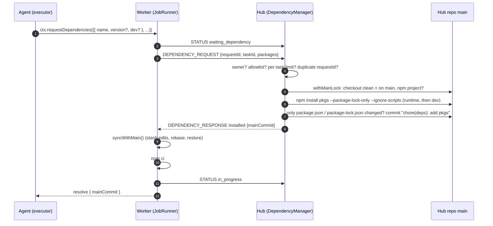

### Two kinds of change

`DEPENDENCY_REQUEST` carries a `change`:

| `change.type` | Fields | Hub action |
|---|---|---|
| `add_dependencies` | `packages: [{name, version?, dev}]` (1–30, distinct names) | `npm install --package-lock-only --ignore-scripts`, one run for runtime and one for dev packages, one commit |
| `set_scripts` | `scripts: {name: command}` (1–10) | Edit `package.json` directly, merging scripts and keeping the indentation and other fields |

**Empty projects.** When the target has no `package.json`, the Hub first writes a minimal one
(`name` from the directory, `version: "0.1.0"`, `private: true`). This lets a brand-new
repository be bootstrapped entirely by agents.

**Script rules:**

- **Names:** `^[a-z][a-z0-9:_-]{0,40}$`.
- **Commands:** single-line, at most 500 characters.
- **Lifecycle scripts refused:** `preinstall`, `install`, `postinstall`, `prepublish`,
  `preprepare`, `prepare`, `postprepare`, `prepack`, `postpack`, `dependencies`. npm runs these
  automatically during installs, including the workers' and QA's `npm ci`.
- **No extra power.** Agents can already run arbitrary programs through `run_command`; scripts
  just make that reproducible for QA.

### Checks, in order

| Check | On failure |
|---|---|
| `requestId` seen before from the same node | Re-send the cached answer, or let the in-flight one arrive; never install twice |
| Sender is the connected implementer of `taskId` | `rejected` |
| Every package name allowed by `--allow-deps` (exact name or `@scope/*`) | `rejected` (whole request) |
| At most 10 requests per task (each may add up to 30 packages) | `rejected` |
| Hub checkout clean and on `main` | `rejected` |
| No `pnpm-lock.yaml` / `yarn.lock` / `bun.lock*` | `rejected` (npm only) |
| Root `package.json` missing | Created (minimal), then the change is applied |
| npm succeeds within 5 min (dependencies) / `package.json` is valid JSON (scripts) | Roll back, `rejected` with the error |
| Only `package.json` / `package-lock.json` changed | Roll back everything, `rejected` |
| Nothing changed (already satisfied) | `installed` with the current main commit, no new commit |

### Why the Hub never runs package code

`--package-lock-only` resolves versions from the registry and writes `package.json` and the
lockfile without creating `node_modules`. `--ignore-scripts` additionally guarantees no
lifecycle scripts run. Without this, an agent asking for a malicious package would get code
execution on the Hub, which holds the canonical repository and the GitHub credentials.

The one exception is a deploy command the operator configured (see
[Deploying after a merge](#deploying-after-a-merge)).

Workers install for real with `npm ci`, which never modifies the lockfile. They already execute
project code, so running install scripts there doesn't widen what an agent can do.

### Pushing dependency commits

Dependency commits land on the **local** `main` in the target directory, and workers on the
LAN fetch them from the Hub. The Hub pushes `main` to `origin` only after merges (see
[Pushing to origin](#pushing-to-origin)), so a dependency commit goes out together with the
next merged task.

### Reconnects

- **Offline when the answer arrives.** If the worker is offline when the Hub answers, the
  answer is dropped. After re-registering, the worker re-sends every pending request, and the
  Hub answers from its cache.
- **Requests sent while offline.** These sit in the worker's outbox and are flushed on
  reconnect, so they are not lost either.

### Effect on the rest of the flow

- **Branch diffs stay clean.** Dependency commits are on `main`, so they are in the merge-base
  of the task branch. The worker's protected-file check (`origin/main...HEAD`) and the Hub's
  pre-QA check (`main...commit`) don't count them as task changes.
- **QA installs them.** QA runs `npm ci` because the task commit now has a
  `package-lock.json`.

## 10. LLM gateway and agent loop

Model inference happens at Anthropic. The **Hub** holds the API key, every conversation and
the prompts. The **worker** runs the loop and executes the tools. Files never leave the
worker; only what the model asks to see (file contents, command output) travels, as tool
results.

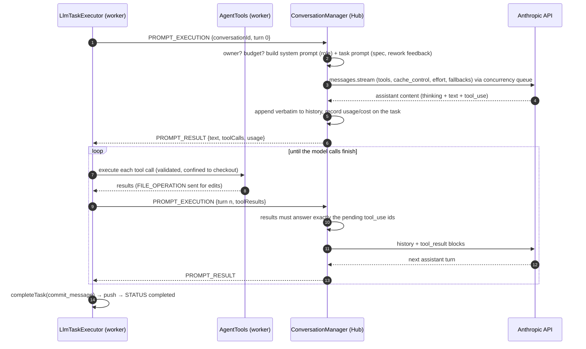

### Why the Hub holds the conversation

- **The model's messages can't be forged.** Workers send only tool results. They can't inject
  a system prompt, rewrite earlier turns or fabricate assistant messages.
- **History is append-only.** Current models bind thinking blocks to the exact conversation
  that produced them, and editing earlier turns invalidates them. The Hub appends each
  response verbatim and never edits.
- **Caching works.** The prefix (tools, system prompt, earlier turns) is byte-stable, and a
  top-level `cache_control` caches it, so each turn re-reads history at the cache rate
  (Opus 5.5: $0.20 vs $4 per million input tokens).
- **Frames stay small.** Only the new tool results travel each turn, not the whole history.
- **Costs are counted centrally.** One place counts tokens and enforces per-task budgets.
- **Restarts are cheap.** Conversations are saved after every turn, so a Hub restart doesn't
  throw away an agent's work in progress (see [When the Hub restarts](#when-the-hub-restarts)).
  A conversation stays alive while its worker is briefly disconnected and is dropped once
  its task moves on.

### Request settings (`AnthropicApiAdapter`)

| Setting | Value | Why |
|---|---|---|
| Model | `claude-opus-5-5` (configurable) | Default current Opus when Anthropic is a provider; task agents can run on another model (`--agent-model`), the Architect always uses this one |
| Transport | `client.beta.messages.stream(...).finalMessage()` | Long agentic turns; streaming avoids HTTP timeouts |
| `max_tokens` | 32,000 per turn (`DEFAULT_MAX_TOKENS`) | Room for large file writes in one tool call. Agents' instructions name the limit and ask for targeted edits and large files in parts, so answers stay under it |
| `output_config.effort` | `high` (configurable) | Agentic coding benefits from effort; `medium` is Opus 5.5's default |
| Thinking | Not set (adaptive) | Opus 5.5 rejects disabling it; history keeps the blocks |
| `cache_control` | `{type: "ephemeral"}` (automatic) | Caches the growing prefix |
| `fallbacks` | `"default"` + `server-side-fallback-2026-07-01` | If the model declines for policy reasons, Anthropic retries on its recommended fallback model |
| Tools | `eager_input_streaming: true`; inputs validated on the worker | Large file contents stream as generated |

### Other providers (`OpenAiCompatibleAdapter`)

Every provider except Anthropic uses the OpenAI-compatible adapter, at its base URL with its key
(see [Providers](#providers-providers)). Conversations keep the Messages API format, and each
request is translated:

| Hub (Messages API) | Chat Completions |
|---|---|
| `system` | first `system` message |
| assistant `text` + `tool_use` blocks | one `assistant` message with `content` and `tool_calls` (arguments as JSON) |
| `tool_result` (with `is_error`) | a `tool` message (prefixed `Error:`) |
| image in a `tool_result` (view_image) | a following `user` message with `image_url` parts with `ASO_LLM_VISION=1`; otherwise a text note |
| `thinking` blocks | dropped (only valid for their own model) |
| a tool call's provider data (Gemini's `extra_content` thought signature) | kept on the `tool_use` block as `aso_provider_data` and sent back as the call's `extra_content`; stripped before any Anthropic request (`withoutProviderData`) |
| tools | `function` tools with the same JSON Schema |

The answer comes back streamed (`stream: true`, `include_usage`), so slow local models keep the
connection alive. Deltas are added up (`accumulateChunks`), `<think>…</think>` text is dropped,
tool-call arguments must parse as a JSON object (otherwise a retryable error, so the turn is
asked again), and finish reasons map to the Hub's: `stop` → `end_turn`, `tool_calls` →
`tool_use`, `length` → `max_tokens` (the cut-off handling below applies), `content_filter` →
`refusal`. HTTP errors: 401/403/404/400 aren't retried; 408, 429 and 5xx are; an
`insufficient_quota` or credit error pauses model calls like Anthropic's credit error. Cached
input reported in `prompt_tokens_details` counts as cache reads. The answer limit goes in the
field the provider's preset names (`maxTokensField`): `max_completion_tokens` for OpenAI, whose
reasoning models refuse `max_tokens`, and `max_tokens` elsewhere.

Prices (`llm/pricing.ts`) are looked up per model name, in order: prices set on the Hub
(`llm/custom-prices.ts`, `<state>/prices.json`, `aso price set`), the built-in Claude table, and
prices a provider reports in its model list (OpenRouter's `pricing`, via `registerPrices`).
Models with none cost $0, so only the turn limit stops them.

### Providers (`Providers`)

`llm/providers.ts` holds where models come from. A provider has an id (what specs start with),
a preset (`anthropic`, `openai`, `openrouter`, `gemini`, `groq`, `mistral`, `ollama`,
`custom`), which gives the kind of API and, for the cloud ones, its base URL, and a key and/or
base URL. Added providers are saved with their keys in `<state>/providers.json` (mode 600); the
`.env` adds `anthropic` (`ANTHROPIC_API_KEY`), the cloud presets whose key it holds
(`ENV_KEYS`: `OPENAI_API_KEY`, `OPENROUTER_API_KEY`, `GEMINI_API_KEY`, `GROQ_API_KEY`,
`MISTRAL_API_KEY`), and `local` (`ASO_LLM_BASE_URL`, `ASO_LLM_API_KEY`, `ASO_LLM_VISION`),
unless an added provider has that id. In Docker, `docker-compose.yml` passes these names into
the container. API answers carry
`hasKey`, never the key.

- **Adding** fetches the provider's model list first, so a refused key or an unreachable
  server fails the request (400) and nothing is saved.
- **Model lists:** Anthropic's `GET /v1/models` (through the SDK), the others' `GET {base}/models`,
  cached 5 minutes per provider. An Anthropic failure offers `CLAUDE_FALLBACK`; another
  provider's failure lists no models and reports the error (`GET /api/providers`, and
  `localError` on `GET /api/models`).
- **Specs:** `<provider>/<model>`; the model part may contain `/` (OpenRouter). `parseSpec`
  also reads the older forms: a bare `claude-…` is `anthropic`'s, `openai:<model>` is
  `local`'s. `adapterFor(spec)` builds the adapter, or throws naming what's missing.
- **Local or not:** `ollama` and `custom` providers are local (`isLocal`), which sets the
  default calls at once for their models (below).
- **The default model:** without `--model`, `defaultModel()` is `claude-opus-5-5` when
  `anthropic` is a provider; otherwise there is none, and the Hub starts without an Architect
  and says to give `--model`.

### A model per desk (`DeskModels`)

`llm/desk-models.ts` maps desks (`<host>#<slot>`) to model specs (`<provider>/<model>`), with
optional per-model settings (calls at once, base URL, vision), in
`<state>/models.json` (mode 600, no secrets; settings of models no desk uses are dropped). Each
model gets its own adapter, built when a desk is put on it (so one the Hub can't use is
refused then; a failed save changes nothing), and its own `Semaphore`. A machine target
(`avalon`) becomes its desks from the connected worker's slot count (`desksOf`).

What can be chosen is every provider's model list. `resolveModel` turns a typed name into a
spec: a listed spec, a model name only one provider offers (`qwen3-coder:30b` →
`ollama/qwen3-coder:30b`; one several offer asks to choose), or an explicit spec of a known
provider as is; otherwise it answers with the closest names (substring, then edit distance).

When a task's conversation starts, `ConversationManager` finds the desk from the task's crew
(the latest member on that node: host and slot) and pins that desk's model on the
conversation, saved with it across restarts. Every call of that conversation goes through the
model's adapter and semaphore; without one, through the default agent adapter and the shared
`--llm-concurrency` semaphore, which the Architect also uses. A desk model the Hub can no
longer use falls back to the default. The task's history notes the model when an agent
conversation starts.

Default calls at once: 1 for local providers' models (one local GPU, where parallel requests
would queue or spill the model out of GPU memory), `--llm-concurrency` for cloud ones.

### Escalation (`llm/escalation.ts`)

`roundModel(policy, task, desk, default)` picks a task conversation's model when it starts, from
the task's `reworkRound` and `refusedModels`: the desk's model (or the default) while
`reworkRound < juniorTries` (the first attempt is round 0, so `juniorTries` counts tries), then the ladder (`--escalate-to`, default `--model`), one step per further round,
skipping refused models. The choice is pinned on the conversation like a desk model, routed
through `DeskModels.route(spec)` (any spec, not only desks'), and named in the history with its
reason. Ladder models the Hub can't build an adapter for are dropped at start, with a warning.

A non-retryable LLM error on a task conversation (`modelRefused`): if `roundModel` with that
model refused gives another model, the task records it in `refusedModels` and sets
`switchingModel`; the worker's `failed` report then requeues the task (`pending`) instead of
failing it, without a rework round. A person's retry clears both.

### Error handling

| Situation | Hub answer | Worker reaction |
|---|---|---|
| No API key | error, not retryable | Task `failed` ("no LLM configured") |
| Rate limit, 5xx, connection, unparseable stream | error, retryable; turn not committed | Retry the same turn after 2/5/15/30/60 s |
| `stop_reason: max_tokens` | error, retryable; not committed. The history notes what the discarded answer held | Retry; the retried turn tells the model its answer was cut off and to keep it shorter (targeted edits, large files in parts) |
| `stop_reason: refusal` (after fallbacks) | error, not retryable | Task `failed` with the category |
| Bad key, bad request, credits exhausted | error, not retryable | Task `failed` with the API's message |
| Task over budget | error, not retryable | Task `failed`; raise `--task-budget` and resubmit |
| Retry of an answered turn (same or new requestId) | Cached answer; the model is not called again | — |

### Tools and their limits

| Tool | Behaviour |
|---|---|
| `list_files` | `git ls-files` (tracked and untracked, honours `.gitignore`); up to 2,000 entries |
| `read_file` | Numbered lines; `offset`/`limit` (default first 2,000 lines); refuses binaries |
| `search` | `git grep -E` over tracked and untracked files; up to 300 matches |
| `view_image` | Shows the model a PNG, JPEG, GIF or WebP in the checkout (e.g. a screenshot the agent saved with `run_command`), up to 2 MB and 8,000 px a side; the type is read from the bytes, not the name |
| `write_file` / `edit_file` / `delete_file` | Exact-match edits (unique unless `replace_all`); protected files refused; reported via `FILE_OPERATION` |
| `run_command` | argv without a shell, in the job sandbox; `CI=1`; default 120 s timeout (max 900); `git`, shells, `sudo` and `npm install`-style commands refused |
| `request_dependencies` | Adds up to 30 npm packages via the Hub in one commit; returns once installed and rebased |
| `set_package_scripts` | Sets npm scripts via the Hub (creates package.json if missing); returns once rebased |
| `finish` | Ends the loop with a summary, a commit message and, for a visible change, the views QA should screenshot; refused if other calls in the same turn failed |

**Stopping without `finish`.** A reply with no tool calls hands nothing in. The worker sends the
next turn with no tool results, and the Hub turns that into a reminder (`CONTINUE_PROMPT`): call
`finish` if done, keep working, or explain the blocker. If the agent stops again right after the
reminder, the worker throws `AgentStoppedError` and reports the task `failed` with the agent's
text. Unfinished work is never pushed, so it never reaches QA or burns rework rounds.

**Limits and safety:**

- **Job sandbox.** See [The job sandbox](#the-job-sandbox) below.
- **Output cap.** Each tool result is capped at 50,000 characters, and a turn's text results at
  about 1.2 MB. Images from `view_image` have their own budget of 5.5 million base64 characters
  per turn (two full-size images); a later image in the same turn is left out, and its result
  says so. Together they stay under the 8 MiB frame limit (`MAX_FRAME_BYTES`).
- **Images in the conversation.** The Hub sends an image to the model as an image block inside
  its tool result. Every image stays in the history and is sent again with each later turn, so a
  conversation holds at most 20 images and 12 MB of them (`CONVERSATION_MAX_IMAGES`,
  `CONVERSATION_MAX_IMAGE_BYTES`), well under the API's 32 MB request limit. Past that, the
  result keeps its text and tells the model the image wasn't shown. The task transcript keeps
  only the text (path, type, size), never the image data.
- **Untrusted paths.** Every model-supplied path is checked twice. The schema forbids absolute
  paths, `..` and `.git`. The worker then resolves the real path (following symlinks) and
  rejects anything outside the checkout.
- **Turn and budget limits.** A conversation (one task attempt or planning round) is capped
  at 80 model turns (`--max-turns`), and each task at its budget (default $5, estimated). In
  the last 10 turns the Hub adds a note after the turn's tool results telling the agent how
  many are left and to wrap up (`withTurnWarning`).
- **Out of credit is a hold, not a failure.** `classify` turns the API's "credit balance is
  too low" (sent mid-stream as a raw JSON body with no status) into `LlmError(…, pause:
  "credit")` with a plain message; other streamed errors also show the API's own words
  (`apiErrorText`). The gateway then sets `paused` (in `GET /api/llm`), notes *waiting* once
  in the task's or plan's history, calls `onPause` (a push notification) and answers the turn
  with `paused: true`. `callModelWithRetry` on workers and the Architect then asks again every
  60 s without using up its retries. The first call that works clears the hold (`onResume`).
- **Unfinished work is kept.** When an agent is cut off (turn limit, budget, the model gone,
  or it stopped without `finish`), the worker commits what is in the checkout as
  `wip: unfinished (…)` and pushes it to `task/<id>` before reporting the failure
  (`AgentGitClient.saveProgress`). A retry resumes that branch, so the next attempt continues
  from it.
- **Idle conversations.** These are dropped after 30 minutes, and as soon as their task is no
  longer being implemented by that node.

### The job sandbox

Agents decide what runs on a worker: their own commands, the test scripts they write, and the
install scripts of packages they request. The program blocklist in `run_command` only stops
honest mistakes, since `node -e` can start anything. So the worker runs every job command
through a `CommandRunner`, and by default that is `DockerSandbox` (`sandbox.ts`). The file
tools and git stay on the host, where they are confined to the checkout.

| Runs in the sandbox | Stays on the host |
|---|---|
| `run_command`, `npm ci` after a dependency change, QA setup steps and test command | File tools (path-checked), all git operations, hardware profiling, the Hub connection |

Each command is its own `docker run --rm` (`dockerRunArgs()`, a pure function with tests):

- **Mounts.** The checkout at the same path, so absolute paths in caches stay valid, with
  `.git` mounted again read-only on top. A container that could write `.git/hooks` or
  `.git/config` would get code run by the worker's next git command on the host. The shared
  cache (`<workDir>/../cache`: npm cache and Playwright browsers) is mounted at `/cache`.
- **Privileges.** The worker's uid:gid (files keep their owner), `--cap-drop ALL`,
  `no-new-privileges`, `--read-only` root filesystem with a 4 GB `/tmp` tmpfs as `HOME`,
  `--pids-limit 4096`, `--init`.
- **Environment.** Only `CI=1`, `HOME`, the cache locations and what the caller passes. Nothing
  of the worker's environment, so no ASO token.
- **Entrypoint.** The program itself, which bypasses image entrypoint scripts (Node's runs unknown
  commands as `node <name>`).
- **Timeouts.** Killing the `docker` client doesn't stop the container, so a timed-out command's
  container is removed with `docker rm -f`. Containers carry a label derived from the work
  directory; leftovers from a crashed worker are removed on the next start.
- **Errors.** Exit 125 (Docker failed) and the init's "exec failed" (program not in the image)
  reject, like a missing program on the host. QA reports that as a node problem, not a test
  failure.

**Image.** By default the worker builds `aso-sandbox:node<major>-<hash>` on first start:
`node:<major>-bookworm`, matching the worker's own Node, plus `playwright install-deps
chromium`. The tag hashes the Dockerfile, so a change rebuilds it once. Browsers are downloaded
into the shared cache by the project's own Playwright version. The full ReadAloud suite (npm ci,
359 unit tests, 36 Playwright e2e tests with a Next.js production build) passes in it.

**Known gaps.**
- **Network.** The default is `bridge`: npm and browser downloads need the internet, so jobs
  can also reach the LAN. `--sandbox-network none` closes that, but then installs fail.
- **Shared cache.** Jobs share the cache. npm verifies what it reads by integrity hash;
  Playwright's browser directory isn't verified.
- **No Docker inside.** Jobs can't run Docker, because mounting the socket would hand them the
  host. `container_build` tasks can write Dockerfiles but not build them on a worker.
- **Fail-closed.** With `--sandbox docker` (the default), a worker without usable Docker refuses
  to start. `--sandbox none` restores the old behaviour explicitly.

### Cost accounting

Each response's token usage (input, output, cache read, cache write) is priced from the Hub's
table (`llm/pricing.ts`, standard API rates as of 2026-10). Cost is added to the task
(`task.llm`) and the Hub totals (`/api/llm`). Refused turns are counted too, because they are
billed.

The figures are estimates: with fallbacks, the price used is that of the model that answered.
Console billing is authoritative.

### Credentials

The Hub uses an Anthropic API key (`ANTHROPIC_API_KEY`). This is the documented route for
applications built on Claude, and it can draw on the monthly API credits included with Max
and Team plans. Consumer subscription logins (claude.ai and Claude Code OAuth) are not used:
Anthropic's terms reserve them for ordinary use of Anthropic's own apps. Automated access to
the claude.ai web UI (e.g. Playwright) is prohibited by the Consumer Terms. The `LlmAdapter`
interface leaves room for other compliant providers (e.g. Claude on Bedrock or Vertex AI).

## 11. Agent roles and planning

### Roles

`ROLE_POLICIES` in `@aso/shared` is the single definition of what each role may do. The Hub
sends each role only its tools, and composes its system prompt. The worker's `AgentTools`
refuses tools and paths outside the policy. The Hub re-checks every branch before QA.

| Role | Tools | Writable | System prompt focus |
|---|---|---|---|
| Architect | `list_files`, `read_file`, `search`, `view_image`, `submit_plan`, `ask_questions` | none | Explore, then split the requirement into independently testable tasks with explicit contracts and dependencies |
| `backend` | explore + edit + `run_command` + `request_dependencies` + `finish` | any (minus protected files) | Data models, DB, API routes; prefers Prisma + PostgreSQL, Hono |
| `frontend` | same | any (minus protected files) | UI; prefers Next.js App Router, Tailwind, shadcn/ui |
| `qa` | same | test files and test config | Tests only; describes bugs instead of fixing feature code; prefers Vitest, Playwright |
| `devops` | same | Dockerfiles, compose, CI, `infra/`, `deploy/`, `scripts/`, `Makefile` | Containers and CI; prefers GitHub Actions |

Every prompt says to follow the project's existing stack when it differs from the
preferences. System prompts and tool lists are byte-stable per role, so they stay in the
prompt cache.

### Planning flow

```mermaid
sequenceDiagram
  autonumber
  actor U as You (aso plan)
  participant H as Hub (PlanManager)
  participant A as Architect node
  participant C as Hub (ConversationManager)
  participant T as TaskManager

  U->>H: POST /api/plans {requirement}
  H->>A: PLAN_REQUEST {planId, requirement}
  A->>A: clone/fetch Hub repo, checkout main (read-only)
  loop until submit_plan is accepted
    A->>C: PROMPT_EXECUTION {planId, turn, toolResults}
    C-->>A: tool calls (list_files / read_file / search / submit_plan)
    A->>A: run read-only tools, validate submit_plan with orderPlan
    Note over A: invalid plan (cycle, unknown key) goes back to the model as a tool error
  end
  alt the requirement leaves something important open
    A->>H: PLAN_RESULT questions {questions}
    H->>H: state awaiting_input (notifies your phone)
    U->>H: POST /api/plans/:id/reply {answers}
    H->>A: PLAN_REQUEST {planId, round + 1}; the prompt now holds the conversation
  end
  A->>H: PLAN_RESULT proposed {summary, tasks}
  H->>H: validate again → state proposed
  U->>H: GET /api/plans/:id (console or aso plan shows it)
  opt you ask for changes
    U->>H: POST /api/plans/:id/reply {changes}
    H->>A: PLAN_REQUEST {round + 1}: the Architect revises its proposal
  end
  U->>H: POST /api/plans/:id/approve
  H->>T: submit tasks in dependency order (keys → task ids)
  T->>T: dispatch tasks whose dependencies are merged
```

- **Approval is required.** A plan never starts work on its own; each task spends credits.
  Planning itself is capped at $3 per planning round (`planBudgetUsd`, `--plan-budget`), counted from the latest reply.
- **One plan per Architect at a time.** Plans queue while no Architect is idle. If the
  Architect disconnects mid-plan, the plan returns to the queue. An Architect that reconnects
  and receives a plan it already answered re-sends its stored answer instead of planning
  again.
- **Talking with the Architect.** The Architect has an `ask_questions` tool next to
  `submit_plan`. When the answers would change the plan, it asks (at most five per round)
  instead of guessing; small details it decides itself and states in the summary. Your
  answers and change requests are replies (`POST /api/plans/:id/reply`), at most 10 per plan.
  - **Each reply is a new planning round.** It is a fresh Architect run, not a resumed model
    conversation: `planPrompt()` puts the requirement plus the whole dialogue (questions,
    answers, superseded proposals, change requests) in the first message.
  - **Why fresh runs.** Live conversations are bound to one Architect node, and are dropped
    when idle or when their plan stops planning. Someone may answer hours later, after a Hub
    restart, to a different Architect. A fresh run only costs re-reading the project.
  - **Budget per round.** Each round gets the full planning budget (`budgetBaseUsd` resets on
    reply).
  - **Cached answers carry the round.** `PLAN_REQUEST` carries `round`, so an Architect's
    cache of answered plans (for requeued duplicates after a reconnect) is keyed by plan and
    round.
- **Plan-local keys.** Proposed tasks use keys (`api`, `login-page`), and `dependsOn` refers
  to keys. Approval submits tasks in dependency order and maps keys to the generated task ids.
- **Linking.** Each created task records its `planId`.

## 12. Authentication

One shared secret, the **ASO token**, gates everything on the Hub except liveness and the
public package.

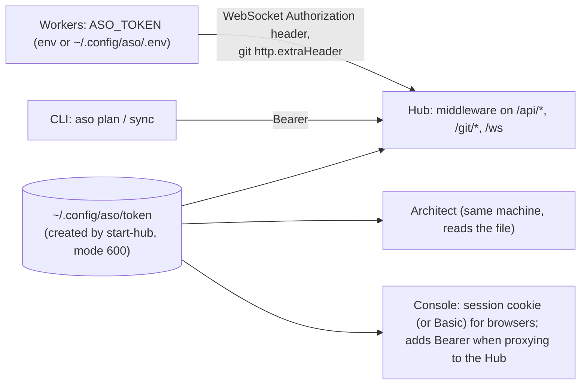

| Surface | How the token is presented | Without it |
|---|---|---|
| WebSocket `/ws` | `Authorization: Bearer` on the upgrade request | `401` before upgrade; the worker logs "check ASO_TOKEN" |
| API `/api/*` | `Bearer`, or Basic with the token as password | `401` with `WWW-Authenticate: Basic` |
| Git `/git/<project>.git/*` | `http.extraHeader` per git command (never in `.git/config`) | `401` (git fails without prompting) |
| Console sign-in link | `aso console-link` or a signed-in console asks the Hub for a one-time code (`SignInCodes`: 18 random bytes, 10 min, single use, at most 20 outstanding, in memory). `/login?code=` posts it from the page, so link previews can't use it up; the console server redeems it at the Hub and sets the session cookie | Used or expired: `/login?error=link` |
| Console | Sign-in page sets an `httpOnly`, `SameSite=Lax` session cookie (`Secure` behind HTTPS) holding `v1.<issued>.<nonce>.<HMAC>`, signed with a key derived from the token, never the token itself (`newSessionValue`/`isValidSession` in `lib/auth.ts`, Web Crypto, so it also runs in the proxy); it lasts 400 days and ends when the token is rotated. Basic auth also accepted. Its proxy to the Hub adds `Bearer` server-side and allows only the console's endpoints | Pages redirect to `/login`; `/api/*` returns `401` |
| `/api/health`, `/api/version`, `/dist/aso.tgz` | none | Health shows only `{status, auth}` |

**Implementation notes:**

- **Constant-time comparison.** Tokens are compared with `timingSafeEqual`.
- **Defaults differ by entry point.** `startHub` requires an explicit `token`; `null` disables
  auth and logs a warning, which only tests use. The CLI always supplies one.
- **No TLS.** The Hub speaks plain HTTP. On an untrusted network, put it behind a TLS reverse
  proxy or VPN.

## 13. Distribution and updates

`npm run package` (`scripts/package.mjs`) builds `release/aso.tgz`:

| Content | What it is |
|---|---|
| `dist/aso.mjs` | The CLI with every JS dependency (Hub, worker, Architect, SDKs) bundled by esbuild, so installing needs no registry access |
| `dashboard.tar.gz` | The Next.js standalone server with its own `node_modules`. It's nested because `npm pack` drops `node_modules`; it's extracted to `~/.cache/aso/dashboard-<version>` on first use |
| `docker/` | Dockerfile and compose file that run this same package (for `start-hub --docker` from an installed package) |
| `package.json` | `aso-cli`, `bin: aso`, and `asoBuild` (the commit, plus `-dirty` if the tree was modified) |

Versions are `<semver>+<asoBuild>`. The CLI finds its files through `layout.ts`, which works
the same whether it runs from a source checkout (`packages/cli/dist`) or an installed package.

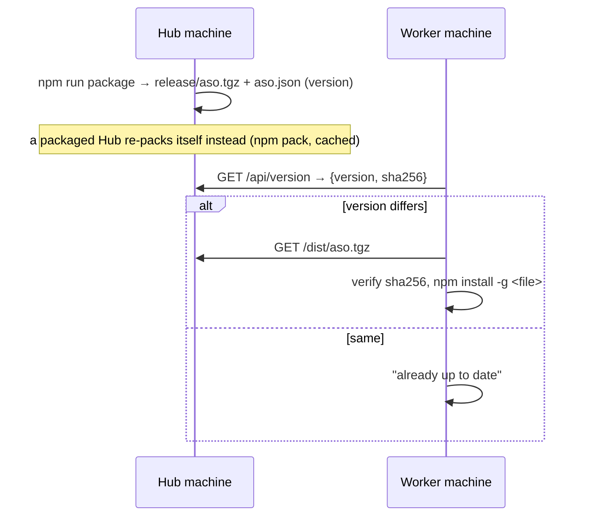

npm 12 refuses remote tarball URLs, so `aso update` downloads the package, verifies its
checksum and installs the local file. First installs do the same by hand with `curl` and
`npm install -g`.

The Docker image builds the package during `docker build`. The CLI passes the host's commit as
`ASO_BUILD`, since the image has no `.git`, so a containerized Hub serves the package too.

### Pull requests

With a GitHub `origin` and a token (`ASO_GIT_TOKEN`), QA-approved work is not merged on the
Hub: a person merges it, on GitHub or from the console. `PullRequests` (`git/pull-requests.ts`) is the task
manager's `ReviewGate`, over `GitHubApi` (`git/github.ts`, a few REST calls on `fetch`).

- **Open.** After QA passes, the task goes to `awaiting_review`. The Hub force-pushes
  `task/<id>` to GitHub (`GitSync.pushBranch`, with the same token header as main pushes) and
  opens a PR, or updates the open one: new body and a "passed QA, ready again" comment. A
  failure is kept in `task.review.error` and the next check tries again.
- **Check.** Every 30 s (and on `POST /api/sync`), each `awaiting_review` task's PR is read:
  - *merged:* `GitSync.catchUp` fast-forwards the Hub's `main` to GitHub's (or merges and
    pushes when the Hub has commits of its own, such as a dependency change). Only then is the
    task `merged`, so dependants branch from a `main` that has it.
  - *closed:* the task is `cancelled`.
  - *changes requested:* the newest approve-or-request-changes review on the PR's current head,
    if it asks for changes and wasn't handled yet (`changesRequested`). GitHub forbids
    requesting changes on your own PR, and the Hub's PRs are its token owner's, so a
    `COMMENTED` review by the PR's author counts as asking for changes. Line comments are read
    from the PR's comment list (`original_line`); the per-review endpoint has no line numbers. The review and its
    code comments become the rework reason and output. Review rounds are counted separately
    (`review.rounds`) and never fail the task; the agent sees one running round number.
  - *conflicting* (`mergeable: false`): catch up `main`, then a normal, counted rework.
- **Review in ASO.** The console's task page shows what a person decides on, through four
  endpoints:
  - `GET /api/tasks/{id}/diff`: the task commit against its merge base with `main`, from the
    Hub's own repository (`HubRepository.diff`, split per file by `parseDiff` in `git/diff.ts`).
    Patches over 100 kB, and any beyond 1 MB in total, are left out (`truncated`).
  - `GET /api/tasks/{id}/checks`: check runs and commit statuses on the PR's head, summed up by
    `summarizeChecks`: failing if any fails, else `unknown` if either list can't be read, else
    pending, passing or none. Fine-grained tokens can't have the *Checks* permission (GitHub
    Apps only), so when check runs are refused the Hub reads the commit's GitHub Actions jobs
    instead (`GitHubApi.actionJobs`, needs *Actions: read*).
  - `POST /api/tasks/{id}/approve`: refuses (409) when the PR's head isn't the commit QA passed,
    when it conflicts, or (without `force`) when the checks aren't passing or none. Otherwise
    it merges on GitHub (`PUT /pulls/{n}/merge` with that `sha`, so a commit pushed meanwhile
    can't slip in), catches up `main`, and applies the same `merged` outcome as the check. While
    it runs, the task can't be cancelled or approved twice (`TaskManager.approving`).
  - `POST /api/tasks/{id}/request-changes`: a review round with the person's words as the
    rework output, plus a comment on the PR. No review id is involved, so nothing is "handled".
- **Cancel** in the console closes the PR with a comment. A retry forgets the PR, so the next
  pass opens a new one.
- **Off** without a GitHub remote, without a token, with `--no-push`, or with
  `ASO_PULL_REQUESTS=0`; `/api/projects` says which (`pullRequests.reason`).

### Workers as services

`aso service install` turns `start-worker` into a systemd **user** service
(`~/.config/systemd/user/aso-worker.service`), so no root is needed. Lingering is enabled
where the system allows it, so the service still starts at boot without a login.

- **The unit is generated** by pure functions in `cli/src/service.ts`: `workerArgs`,
  `serviceUnit`, `systemdQuote`.
- **ExecStart runs the same `aso`** (Node binary plus script) the install ran from, with
  `Restart=always`. A global `npm install` replaces the files in place, so after `aso update`
  only a restart is needed, and `aso update` does it when the service is active.
- **The token never goes into the unit.** The worker already finds a token in the token file
  or `~/.config/aso/.env`. Any other token goes to `~/.config/aso/worker.env` (0600) through
  `EnvironmentFile=`.
- **Each start registers a new node id** (the worker's id has a random suffix). A crash in the
  middle of a job is therefore handled like any disconnect: the job is held for the
  reconnect grace period, then reassigned.

### The Hub as a service

`aso hub-service install` does the same for `start-hub`
(`~/.config/systemd/user/aso-hub.service`), sharing the install, linger, status and logs code
in `cli/src/commands/service.ts`.

- **Arguments:** `explicitArgs` keeps the options whose Commander value source is `cli`,
  plus `--root` made absolute. Defaults and `ASO_*` values from `.env` are read again at each
  start, so editing `.env` and restarting is enough.
- **The Architect** is a child process of `start-hub` when it runs as the unit's main process
  (`runsAsSystemdService`), not a tmux session. A tmux server started from the service would
  live in its cgroup, take in tmux sessions started later, and be killed with them on a
  restart. The child is started again `ARCHITECT_RESTART_MS` (10 s) after it exits. On a
  crash of the main process, systemd stops the rest of the cgroup before restarting.
- **With `--docker`,** the unit runs `docker compose up --build` attached, as `start-hub
  --docker` does in a terminal. SIGTERM reaches compose, which stops the container.
- **The install refuses** while a Hub answers `/api/health` on the port, unless that Hub is
  the service itself.
- **`aso update`** restarts an active Hub service when it installed a package. A source
  checkout also serves the console and package it was built with, so it says to run
  `build:dashboard`, `package` and `aso hub-service restart` instead.

### The Hub updating itself

`HubUpdater` (`cli/src/self-update.ts`) runs in the host process of `start-hub --update-from
<git-url>` (beside the Architect and the host deploy runner), only for a version installed by
`aso hub-service install --update-from` and run as the service.

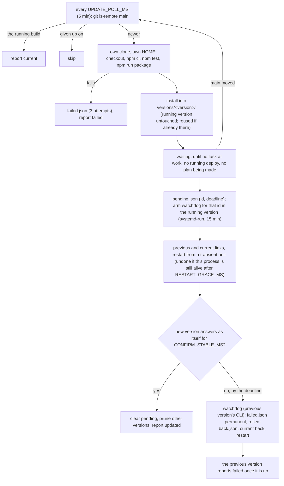

- **Versions** (`HubVersions`, `cli/src/hub-versions.ts`): each in `versions/<version>/` under
  `~/.local/share/aso/hub/`, installed with `npm install --prefix` into a temporary folder that
  is renamed into place. The service's `ExecStart` runs `current/node_modules/aso-cli/dist/aso.mjs`.
  Switching and rolling back replace the `current` link with one rename, so neither can leave a
  half-installed Hub, and a failed install changes nothing.
- **The watchdog lives in the old version.** Code in the new version can't roll back a version
  that crashes at load or hangs, so before switching the running version starts
  `systemd-run --user --on-active=900 <its own CLI> hub-update-check --id <id>`
  (`armUpdateWatchdog`). That transient unit is outside the Hub service, so the restart doesn't
  stop it. `rollbackUnconfirmed` acts only on its own update (`pending.id`), and only if
  `current` points at that update's version: a switch that never happened clears `pending`
  without blaming the commit. Without a watchdog there is no switch.
- **Reboots.** A transient timer doesn't survive one, so the unit also has
  `ExecStartPre=-<node> <root>/previous/.../aso.mjs hub-update-check --at-start`: before every
  start, the version before the last update rolls back an update past its `deadline`, and the
  start then runs the previous version. `-`: a failing check never blocks a start. The unit sets
  `ASO_HUB_HOME`, so the install, the service and the watchdog agree on the folder.
- **Restarting.** `restartHubService` asks for the restart from a transient unit
  (`systemd-run ... systemctl --user restart aso-hub.service`): stopping the service kills every
  process in it, so a `systemctl` started from the Hub itself was killed mid-way and reported a
  failure although the restart went ahead. Its answer is not trusted either way: the updater waits
  `RESTART_GRACE_MS` (2 min), and only a process still alive then undoes the switch.
- **Order.** `afterStart` (confirming) runs before the first `check()`, so pruning old versions
  never races an install, and a new update never starts while the last one is unconfirmed.
- **Confirming** (`afterStart`) polls `GET /api/hub/update`, whose `current` is the version the
  answering Hub runs, so an old container still on the port doesn't count.
- **State** (`UpdateState`, `<root>/update/`, root `~/.local/share/aso/hub` or `ASO_HUB_HOME`): `pending.json`,
  `rolled-back.json` (deleted once its report reached the Hub) and `failed.json`, each written to
  a temporary file and renamed.
- **The build's environment** (`buildEnv`, for `npm ci`, `npm test` and `npm run package`):
  `PATH`, the locale and the user name, with `HOME` and the XDG folders under `build/home`. It
  keeps the Hub's variables (tokens, API key) from the build, but it is not a sandbox: the code
  runs as the Hub's user. git runs with the Hub's own environment, so SSH remotes work.
  `ASO_BUILD` names the package after the commit, and a package not named after it is refused:
  a mismatch would rebuild and reinstall on every pass.
- **Failures** are reported, including a repository that can't be read. A build that fails is
  tried 3 times; a version that didn't confirm, never again.
- **The first install** (`hub-service install --update-from`) refuses a `release/aso.tgz` that
  isn't the checkout's commit or was built with uncommitted changes, and runs the installed
  CLI's `start-hub --help` and `hub-update-check --help` before writing the unit.
- **Reports** go to `POST /api/hub/update` (`HubUpdateReportBodySchema`). The Hub adds its own
  version and the time, keeps the last report for `GET /api/hub/update`, and notifies when an
  update ends (`hubUpdateNotification`: `updated` or `failed`, once per outcome).
- **Busy** comes from `TASK_AT_WORK` in `@aso/shared`, a map over every task state, so a new
  state has to say whether a restart would interrupt it.

### Keeping a project's copy of the Hub API in sync

`syncApiCopies` (`hub/src/api-sync.ts`) runs once when the Hub starts. For each project whose
`main` has a `docs/openapi.json` titled like the Hub's own description (`openApiDocument`) but
different from it:

1. **Catch up first.** `ProjectSet.followForPlanning`, then read the copy again: it may have been
   synced on GitHub already. Projects without a copy cause no fetch.
2. **Seed the branch.** `HubRepository.seedTaskBranch` writes the new description (as
   `npm run openapi` writes it) into `task/<id>` as one commit on top of `main`, by "ASO Hub",
   through a temporary index (`GIT_INDEX_FILE`, plain `git`, since simple-git refuses that
   variable), so the checkout and `main` are untouched. A worker taking the task continues from
   that branch (`startTask` resumes an existing task branch).
3. **Queue the task** (`syncTaskSpec`, role `frontend`): what changed per `apiChanges`
   (operations as `METHOD /path` and `schema Name`, at most 40 of each named), regenerate and
   fix, no new features, keep the copy as it is.

The task id is `sync-hub-api-<hash of project id and description>`, so each project gets one
task per version of the description, and a cancelled one is not queued again. Failures are
logged, never thrown; `close()` waits for the run, so it never outlives the Hub.

### Deploys and the Hub's update outside aso-ui

The core works without any separate UI: both are in the console and the CLI.

- **Console.** `deployView` and `hubUpdateView` (`dashboard/lib/view.ts`) turn `Project.deploy`
  and `GET /api/hub/update` into a label, a tone and details. The project page shows the deploy
  and **Deploy now** (`POST /api/projects/{id}/deploy`, allowed by the proxy's `hub-routes.ts`).
  The home page shows the Hub's status, plus a banner when an update failed.
- **CLI.** `aso status` and `aso deploy` (`cli/src/commands/status.ts`) use the same endpoints,
  through `cli/src/hub-api.ts`, which `aso plan` shares. Their lines come from pure functions
  (`hubLine`, `workerLine`, `projectLine`, `deployLine`). `deployEnded` waits for the deploy that
  started after the request, not one already running.

### Worker keys and workers anywhere

`WorkerKeys` (`hub/src/worker-keys.ts`) gives each worker machine its own credential:

- **Joining.** `POST /api/worker-keys/join-codes` (main token) creates a one-time code (18
  random bytes, 30 min, at most 20 outstanding, in memory). The new machine trades it at
  `POST /api/worker-keys/join` (public; wrong codes are limited to 30 a minute Hub-wide) for a
  key: `asow_` plus 32 random bytes. The Hub stores only its sha256, in
  `<state>/worker-keys.json` (mode 600), and the machine stores the key in
  `~/.config/aso/worker-key`, which `resolveWorkerToken` prefers after `ASO_TOKEN`.
- **Scope.** `requireWorker` guards `/ws` and `/git/*`, where it accepts the main token or a
  valid worker key. Everything under `/api/*` still needs the main token, so a key can't plan,
  approve, merge, deploy or read the API. Git's push rules (task branches only) apply to everyone.
- **What a key may register.** A connection made with a key may register a worker, never the
  Architect (which reads every requirement and writes the plans people approve), and never a
  node id another credential registered (`nodeOwners`, so it can't take over another machine's
  held jobs). One worker per key: a newer registration replaces the older connection (a machine
  back after a power cut), so a key never runs two workers, e.g. one implementing and one passing
  its own QA. Pushes made with a key must go to a task this key's worker implements, or just
  implemented when it was cancelled or failed, so the agent's unfinished work is saved
  (`mayPush` in `gitHttpHandler`).
- **What reaches GitHub.** A pull request gets the commit QA passed (`pushBranch(branch,
  task.commit)`), not whatever is on the Hub's task branch by then.
- **Revocation** marks the key, saves it (a failed save answers 500: unlike other state, key
  saves throw), and cuts every connection made with it at once (`terminate`, node dropped).
  Connections opening at that moment and every later message re-check `isActive`, and Git
  checks the key per request. Each node shows `workerKey` (`{id, name}` or `null` for the main
  token) in `/api/nodes`, the console and `aso status`.
- **Joining.** Wrong codes are slowed down per client address (30 a minute); a valid code always
  joins, so a flood can't keep a machine out, even behind a proxy where every client shares an
  address. A join whose save fails answers 500 and leaves no key behind. The printed join steps download into a fresh private folder (`mktemp -d`) and
  check the package against the Hub's SHA-256 before installing it. The machine's key wins over an `ASO_TOKEN` left in its environment, and it is
  written to a new owner-only file that is renamed into place.
- **Node owners survive a restart.** `NodeOwners` (`hub/src/node-owners.ts`) saves which
  credential registered each node id in `<state>/node-owners.json` (mode 600), so right after a
  Hub restart a job held for a worker still belongs to that worker's credential, and no other
  credential can register its node id to claim it. On each start the Hub keeps only the node ids
  a task still names (`nodeId` or `qaNodeId`), so the file doesn't grow with every worker start.
  Within one run a node id stays with its credential even after the node is gone.
- **The transport check runs before every connection,** not only at start: `startWorker` calls
  `checkHub` (the CLI's `checkTransport`) before each attempt when `--hub` was given, because a
  name can resolve to another address later. A refusal is logged and retried with the usual
  back-off. Discovered addresses are private by construction.
- **Credentials stay out of the process list.** Git gets them as `-c include.path=<file>`
  instead of `-c http.extraHeader=...`: `gitHeaderConfigFile` (`shared/src/git-auth.ts`) writes
  the header into an owner-only file in a private folder (mode 700) under the temp directory,
  removed when the process exits (a killed process leaves it, still owner-only). Values are
  quoted, and a credential with a control character is refused. Workers and the Architect
  (`AgentGitClient`) send their key to every remote; the Hub sends its GitHub token
  (`gitBasicAuthConfig`, in `GitSync` and when connecting a project to GitHub) only to the
  remote's host, through an `[http "<origin>/"]` section.
- **Known limits.** `100.64.0.0/10` counts as private for Tailscale, but carrier-grade NAT uses it
  too. With `--sandbox none`, job commands run as the worker's user and can read the
  credential file, as they could read the key before.
- **Transport.** Workers dial out, so their location doesn't matter. `checkTransport`
  (`cli/src/join.ts`) refuses plain `ws://` when the Hub's address resolves to a public IP
  (`isPrivateAddress`: loopback, RFC 1918, link-local, Tailscale's 100.64.0.0/10 and ULA
  addresses count as private), unless `--allow-insecure`. With `wss://`, Git and package
  downloads use `https://` too (`hubGitUrl`, `hubHttpBase`).

### Finding the Hub on the LAN

A worker started without `--hub` finds the Hub by UDP broadcast, so the Hub's machine needs no
fixed address. The protocol is in `shared/src/discovery.ts`, the responder in
`cli/src/discovery-responder.ts`.

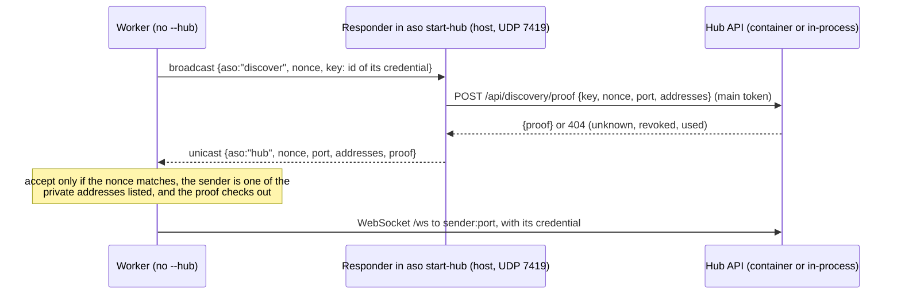

- **The proof.** The secret is the credential's sha256, which is exactly what `WorkerKeys`
  stores of a key, so the Hub can prove it holds a key it can't recover. The query names the
  credential by `sha256(secret)` (first 32 hex characters). The proof is HMAC-SHA256, keyed with
  the secret, over the version, nonce, port and sorted addresses. The Hub matches the id against
  its own token, unrevoked worker keys and unexpired join codes (so a machine joining finds the
  Hub with its code), and answers 404 for anything else.
- **Why the addresses are signed.** An impostor that overhears a real answer could resend its
  proof from its own address. The worker accepts an answer only from an address the proof
  covers, so a resent proof only ever points at the real Hub. Answers from public addresses are
  refused: discovery is for the LAN.
- **Where the responder runs.** Broadcasts don't reach a container on Docker's bridge network,
  so the responder runs in the host process: `startHubCommand` beside the in-process Hub, or
  `startHubInDocker` once `/api/health` answers. The image's own `start-hub` runs with `--no-discovery`. It reads the machine's IPv4 addresses on each
  query, so a new DHCP lease shows at once, and asks the Hub's API for the proof, so the
  container keeps the keys. It answers at most 30 queries per 10 s. If the port is taken, the Hub
  runs on without discovery and logs that.
- **On the worker.** `startWorker` takes `locate` along with an optional `hub`. Before the first
  connection without an address, and before every reconnect after a failed or lost one, it calls
  `locate` (`discoverHub`: three sends to `255.255.255.255` and each interface's broadcast
  address, two seconds of waiting). A different answer replaces the URL, and the Git URLs follow
  it. With `--hub`, `locate` isn't set and the address is used as given. `aso service install`
  without `--hub` writes a unit without it.
- **Limits.** IPv4 only. Broadcasts stay in one network: Tailscale, other subnets and VPNs need
  `--hub`, and so does Wi-Fi with client isolation. The responder's port is fixed for workers at
  7419.
