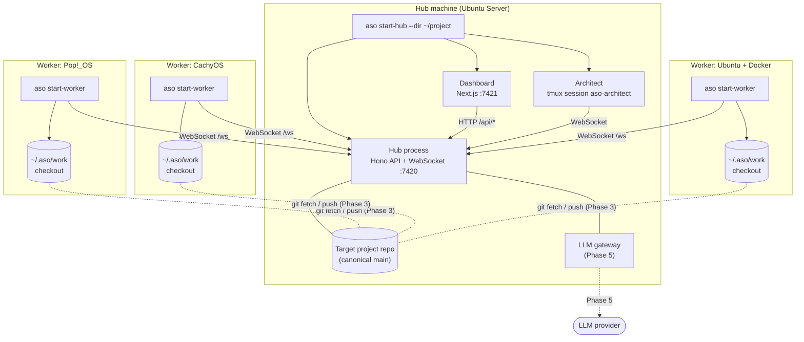
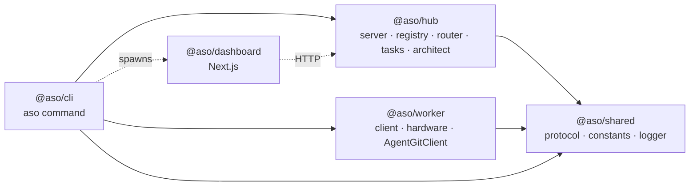
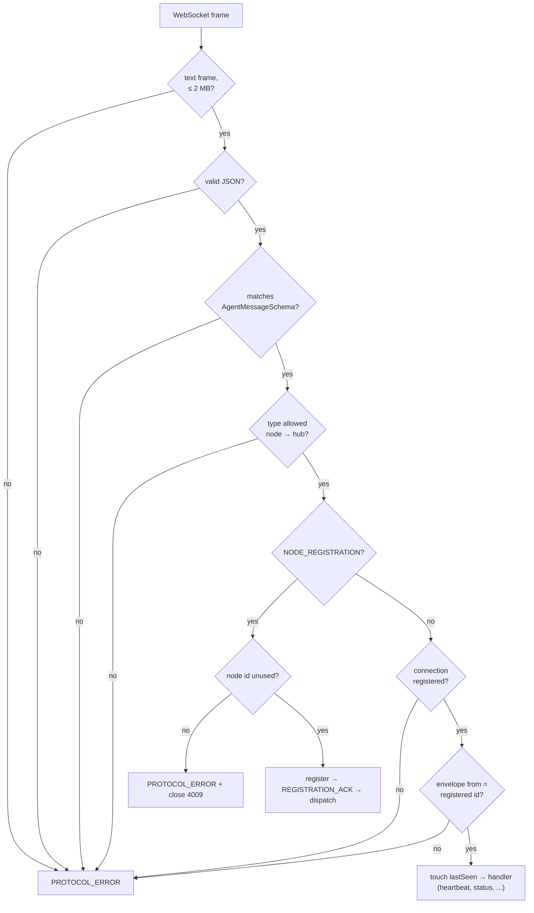
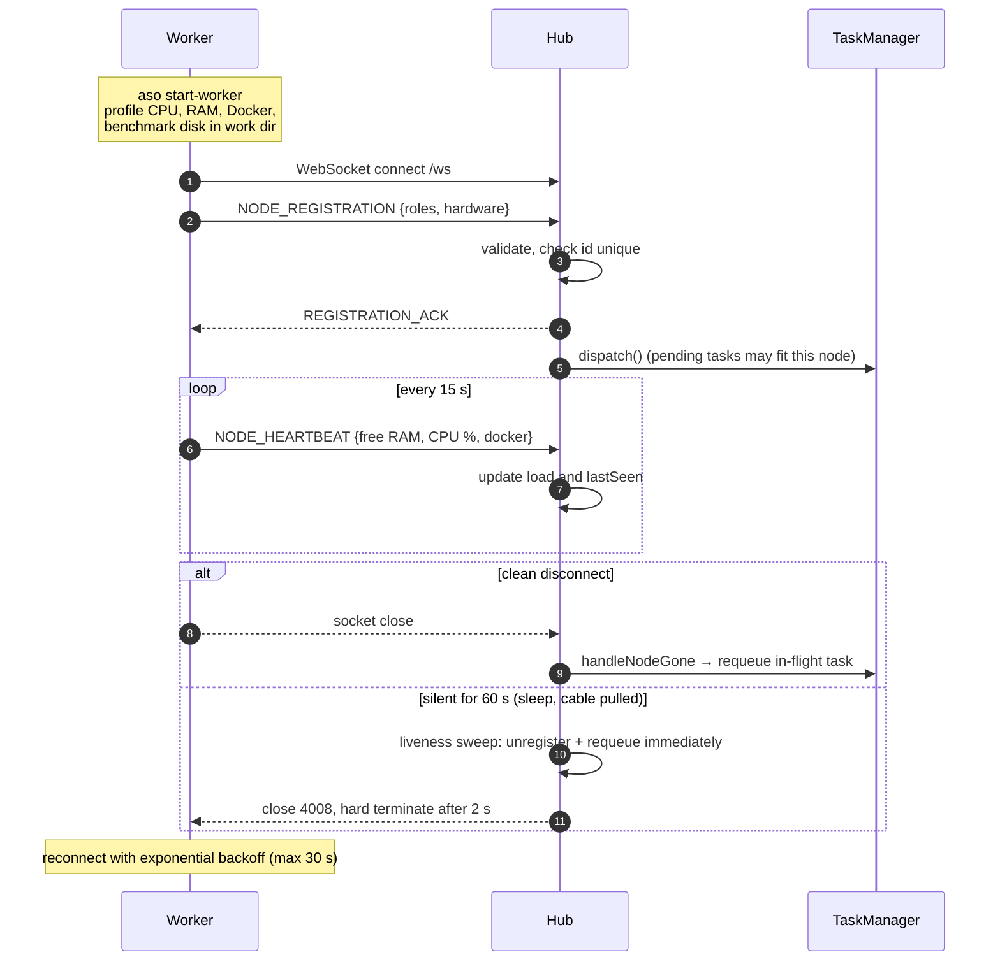
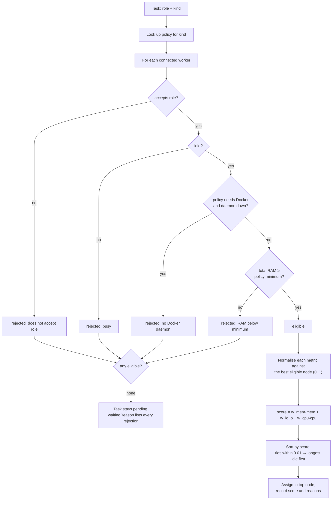
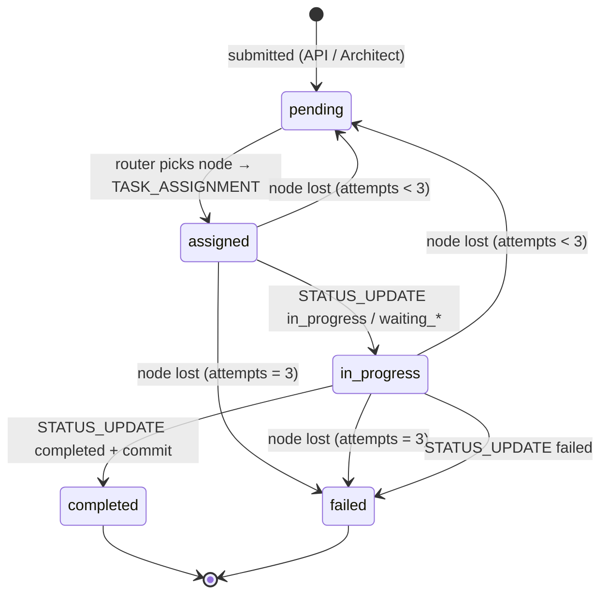
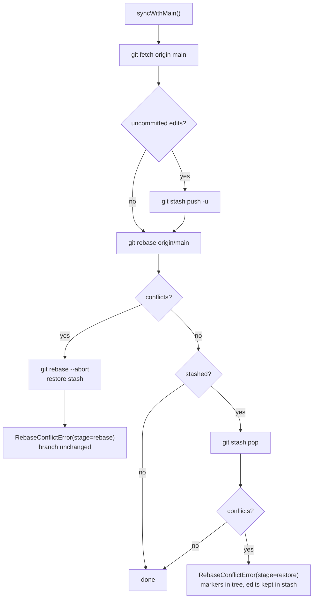
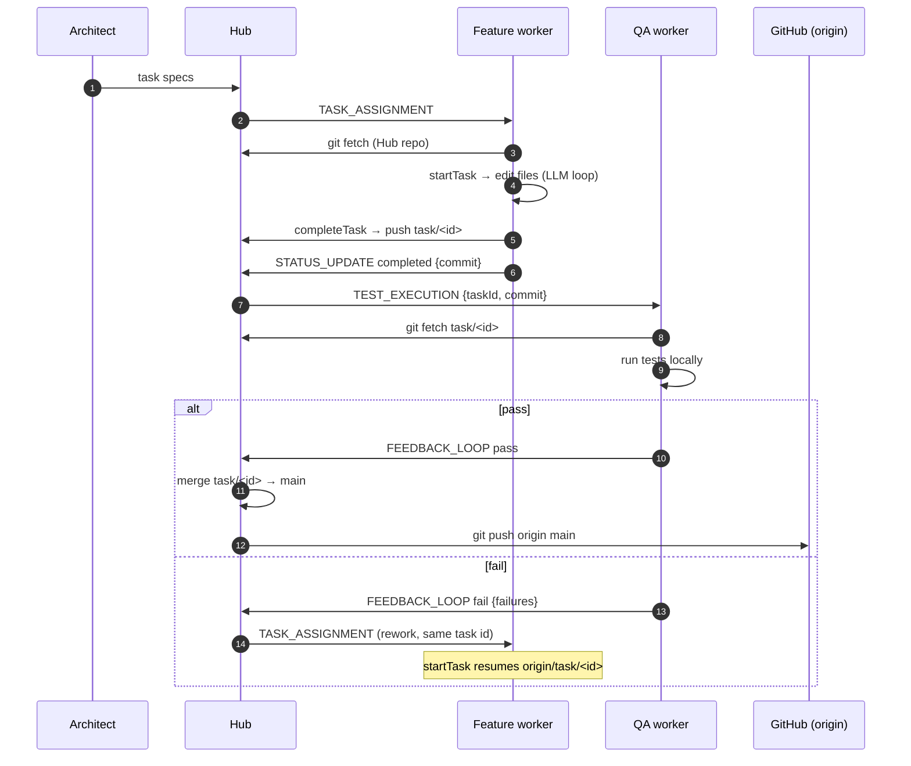
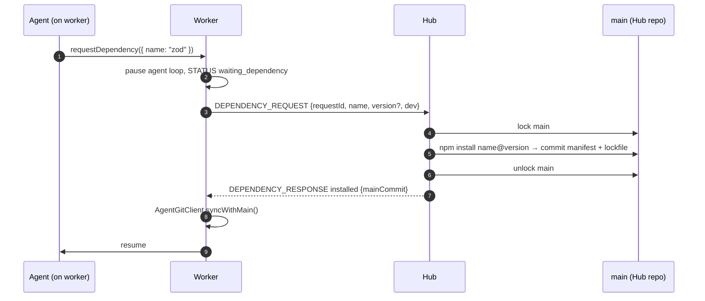

# ASO Architecture

This document describes how ASO works. Sections marked **(planned)** are designs for phases not
yet implemented; everything else reflects the code. Diagrams are Mermaid and render on GitHub
and in most Markdown editors.

1. [Design principles](#1-design-principles)
2. [Deployment topology](#2-deployment-topology)
3. [Components and packages](#3-components-and-packages)
4. [Communication protocol](#4-communication-protocol)
5. [Node lifecycle](#5-node-lifecycle)
6. [Hardware-aware routing](#6-hardware-aware-routing)
7. [Task lifecycle](#7-task-lifecycle)
8. [Git flow](#8-git-flow)
9. [Dependency RPC (planned)](#9-dependency-rpc-planned)
10. [LLM gateway (planned)](#10-llm-gateway-planned)
11. [Agent roles (planned)](#11-agent-roles-planned)

---

## 1. Design principles

- **Hub and spoke.** Every message goes through the Hub. Agents never talk to each other.
- **Central control, local execution.** The Hub owns planning, routing, the canonical Git repo
  and LLM access. Workers own file edits, compilation and tests on their own hardware.
- **Untrusted input everywhere.** Every WebSocket frame and API body is validated against strict
  Zod schemas before use.
- **No raw Git or package manager for agents.** Agents edit files. Branching, committing, pushing
  and dependency changes go through narrow, typed wrappers.
- **The orchestrator is separate from the target project.** ASO runs from its own install and
  operates on the repository given by `--dir`.

## 2. Deployment topology



Today all of this runs directly on the host. The Hub and dashboard are not containerized yet.

`aso start-hub` runs three processes:

1. The **Hub** runs in-process: the API, the WebSocket server, the registry, the router and
   the task queue.
2. The **dashboard** is a child process. It runs `next start` if built, `next dev` otherwise.
3. The **Architect** runs in a detached tmux session. It connects back to the Hub over
   WebSocket like any other node. It survives terminal disconnects and can be watched with
   `tmux attach -t aso-architect`.

## 3. Components and packages



| Package | Key modules | Responsibility |
|---|---|---|
| `@aso/shared` | `protocol.ts` | `AgentMessageSchema`, task and hardware schemas, `createMessage`, `parseAgentMessage` |
| `@aso/hub` | `server.ts` | HTTP API, WebSocket handling, validation pipeline, liveness sweep |
| | `registry.ts` | `NodeRegistry`: connected nodes, heartbeats, busy state |
| | `routing.ts` | `selectNode()`: a pure, deterministic routing function |
| | `tasks.ts` | `TaskManager`: queue, dispatch, status handling, requeue |
| | `architect/main.ts` | Architect process (connect and register; planning comes in Phase 5/6) |
| `@aso/worker` | `client.ts` | Connect, register, heartbeat, receive tasks |
| | `hardware.ts` | `systeminformation` profile and disk write benchmark |
| | `git/agent-git-client.ts` | The only Git interface agents get |
| `@aso/cli` | `index.ts`, `commands/*` | Argument parsing and process orchestration |
| `@aso/dashboard` | `app/page.tsx` | Read-only view of nodes and tasks |

## 4. Communication protocol

### Envelope

Every WebSocket frame is one JSON object:

```json
{
  "id": "uuid",
  "from": "node id, or \"hub\"",
  "timestamp": "ISO-8601",
  "type": "TASK_ASSIGNMENT",
  "payload": { }
}
```

`AgentMessageSchema` is a Zod discriminated union on `type`. Every object is strict, so unknown
keys are rejected.

### Message types

| Type | Direction | Phase | Purpose |
|---|---|---|---|
| `NODE_REGISTRATION` | node → hub | 1 | First message. Workers send roles and hardware profile; the Architect sends only its kind |
| `REGISTRATION_ACK` | hub → node | 1 | Registration accepted |
| `NODE_HEARTBEAT` | node → hub | 2 | Every 15 s: free RAM, CPU load, Docker availability |
| `TASK_ASSIGNMENT` | hub → node | 2 | A `TaskSpec` (role, kind, title, description, criteria, files) |
| `STATUS_UPDATE` | node → hub | 2 | `accepted`, `in_progress`, `waiting_*`, `completed` (with commit), `failed`, `idle` |
| `FILE_OPERATION` | node → hub | 3 | Audit trail of create, update, delete and rename |
| `TEST_EXECUTION` | hub → node | 3 | QA: test a specific commit with a given argv |
| `FEEDBACK_LOOP` | node → hub | 3 | QA verdict: `pass`, or `fail` with at least one failure |
| `DEPENDENCY_REQUEST` | node → hub | 4 | Ask the Hub to add an npm package |
| `DEPENDENCY_RESPONSE` | hub → node | 4 | `installed` (with the main commit) or `rejected` |
| `PROMPT_EXECUTION` | node → hub | 5 | LLM request. No system prompt: the Hub picks it by role |
| `PROMPT_RESULT` | hub → node | 5 | LLM response or a retryable or permanent error |
| `PROTOCOL_ERROR` | hub → node | 1 | Why a message was rejected, with the offending message id |

### Validation pipeline (Hub)



Schema-level rules worth knowing:

| Field | Rule | Why |
|---|---|---|
| `taskId` | `^[a-z0-9][a-z0-9-]{0,63}$` | Used directly as the branch name `task/<id>` |
| Repo paths | relative; no `..`, `.git`, `~`, `\` | Cannot escape the checkout |
| `DEPENDENCY_REQUEST.name` / `version` | npm name grammar; semver range characters only | No git URLs, `file:` specs or shell metacharacters |
| `STATUS_UPDATE` | `taskId` required unless `idle`; `commit` required for `completed` | Every completion is traceable to a commit |
| `FEEDBACK_LOOP` (`fail`) | `failures` must be non-empty | Feedback is actionable |
| `PROMPT_EXECUTION.messages[].role` | `user` or `assistant` only | Nodes cannot override the role's system prompt |

## 5. Node lifecycle



Notes:

- **Node ids** are `<hostname>-<random>` for workers and `architect-<uuid>` for the Architect.
  They are fixed for the life of the process, so a reconnect reuses the same id.
- **Stale closes.** Unregistering is tied to the connection. A late `close` event from an old
  socket cannot evict a node that has already reconnected under the same id.
- **Architect keepalive.** The Architect has no load metrics, so it keeps itself alive by
  sending `STATUS_UPDATE {state: "idle"}` every 15 s.

## 6. Hardware-aware routing

### Inputs

| Metric | Source | Refreshed |
|---|---|---|
| Logical cores, total RAM, disks, OS | `systeminformation` at boot | Registration |
| Disk write MB/s | 64 MiB sequential write + `fsync` in the worker's work dir | Registration |
| Free RAM, CPU load %, Docker daemon reachable | `systeminformation` | Every heartbeat (15 s) |

The disk benchmark runs in the **work directory**, not `/tmp`. On CachyOS and similar
distributions `/tmp` is tmpfs and would report RAM speed. The work directory is where checkouts,
builds and test databases actually live.

### Algorithm

`selectNode(request, nodes, policies)` in `packages/hub/src/routing.ts` is a pure function.



The metrics are:

- **Memory:** free RAM from the latest heartbeat, falling back to the registration value.
- **I/O:** the measured disk write speed.
- **CPU:** effective cores, calculated as logical cores × (1 − CPU load).

### Policies

| Kind | Hard constraints | w_mem | w_io | w_cpu |
|---|---|---|---|---|
| `feature` | — | 0.2 | 0.2 | 0.6 |
| `unit_test` | — | 0.3 | 0.2 | 0.5 |
| `e2e_test` | total RAM ≥ 4 GiB | 0.7 | 0.1 | 0.2 |
| `db_migration` | — | 0.1 | 0.8 | 0.1 |
| `container_build` | Docker daemon running | 0.3 | 0.3 | 0.4 |

Pass `startHub({ policies })` to override them. Scores are relative to the current fleet, so
adding a faster machine changes which node is "best" without retuning anything.

## 7. Task lifecycle



- **Queue order.** The queue is FIFO. `dispatch()` runs whenever something could unblock a task:
  a submission, a node registering, a task completing or failing, or a node leaving.
- **One task per node.** The node is marked busy at assignment and released on `completed` or
  `failed`.
- **Ownership.** Status updates are accepted only from the node that owns the task. Any other
  node gets a `PROTOCOL_ERROR`.
- **Phase 3 additions.** The QA states `testing`, `merged` and `rejected` will be added here.

## 8. Git flow

### Implemented: `AgentGitClient`

Agents cannot run `git`. The worker wraps `simple-git` in four operations:

| Method | Behaviour |
|---|---|
| `cloneOrOpen(dir, url)` | Use an existing checkout, or clone the Hub repo |
| `startTask(id)` | Requires a clean tree. Fetches, then checks out `task/<id>` from `origin/task/<id>` if it exists (rework), otherwise from `origin/main` |
| `completeTask(msg)` | Rejects changes to protected files. Stages everything, commits as the agent identity, pushes with `--force-with-lease` |
| `syncWithMain()` | Stashes uncommitted edits, rebases onto `origin/main`, restores edits. Conflicts abort cleanly |

**Protected files** may not change on task branches, anywhere in the tree: `package.json`,
`package-lock.json`, `npm-shrinkwrap.json`, `yarn.lock`, `pnpm-lock.yaml`, `bun.lock` and
`bun.lockb`. The check covers both uncommitted edits and commits already on the branch
(`origin/main...HEAD`), so committing first can't get around it.



simple-git does not reject when git exits non-zero with an empty stderr. That happens, for
example, with `rev-parse --verify --quiet` and with a conflicting `stash pop`. The client
therefore checks command output and repository state directly instead of relying on exceptions.

### Planned: end-to-end flow (Phase 3)



Open decision for Phase 3: how workers reach the Hub repo. The options are git over SSH, or a
Git smart-HTTP endpoint served by the Hub, which needs no per-worker SSH keys and lets the Hub
reject pushes outside `task/*`.

## 9. Dependency RPC (planned)



The Hub runs `npm install` with `execFile` (no shell). Package names and versions are already
constrained by the schema.

## 10. LLM gateway (planned)

Workers send `PROMPT_EXECUTION`. The Hub queues it, adds the system prompt for the node's role,
and passes it to a provider adapter behind a common interface. That interface supports
rate-limit-aware queuing, retries, and swapping providers.

Driving the claude.ai consumer web UI through Playwright would break Anthropic's Consumer Terms,
which prohibit automated access. The default adapter is therefore the official API; any
web-bridge adapter stays optional and off by default.

## 11. Agent roles (planned)

| Role | Scope | Notable restrictions |
|---|---|---|
| Architect | Planning, schema design, task specs | Writes no code; runs only on the Hub |
| Backend | Prisma schemas, PostgreSQL logic, Hono routes | — |
| Frontend | Next.js App Router, Tailwind, shadcn/ui | — |
| QA | Vitest and Playwright suites; submits `FEEDBACK_LOOP` | Never writes feature code |
| DevOps | Dockerfiles, CI pipelines | — |

The Hub enforces roles. It picks the system prompt and the tool set from the node's registered
role. The protocol already prevents nodes from supplying a system prompt.
