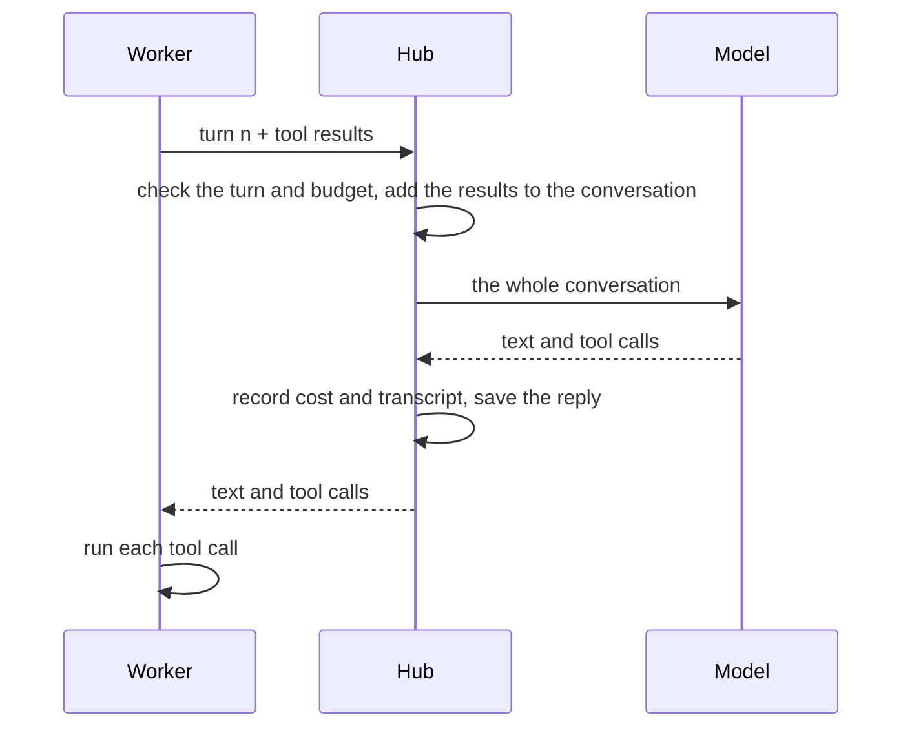

# How an agent talks to its model

What actually goes back and forth while an agent works on a task: who does what, what the model
receives on each turn, and what it sends back. For the design behind it, see
[LLM gateway and agent loop](../ARCHITECTURE.md#10-llm-gateway-and-agent-loop).

The examples use a small made-up task on `aso-test`. The JSON is OpenAI's Responses format, shortened
with `…`; other providers get the same content in their own format ([below](#the-format-per-provider)).

## Who does what

A builder is two things, and the Hub sits between them:

| Part | Where | What it does | What it never has |
|---|---|---|---|
| **The model** | At its provider, or in Ollama on a worker machine | Decides the next step. It can only ask for tool calls; it can't run anything | Access to the project, or memory between calls |
| **The worker** | The machine with the desk | Runs the loop, carries out the tool calls in the task's checkout, and runs commands in the sandbox | API keys, the conversation, the prompts |
| **The Hub** | The Hub machine | Holds the conversation, builds every request, counts cost and turns, enforces budgets, writes the transcript | The checkout the agent works in |

## From task to first turn

1. **The Hub assigns the task.** It picks a free desk and sends the worker `TASK_ASSIGNMENT`: the
   task, the project and, on a rework round, why the task came back. No model is involved yet.
2. **The worker prepares.** It opens the desk's checkout, creates or continues the `task/<id>` branch,
   and runs `npm ci` if the dependencies changed.
3. **The worker sends turn 0.** It makes up a conversation id and sends the turn number with no tool
   results. That is only a "start": the Hub already holds the task and builds the first request itself.

Each round of a task is a new conversation. A rework round starts fresh, from the code saved on the
branch and a brief that says what went wrong.

## One turn



A **local model** takes the same path, with one more hop. The Hub sends the finished request back over
the machine's own connection, and the worker there calls its Ollama and returns the answer. So the
conversation, costs and transcript stay on the Hub, and a machine's local model serves only that
machine's jobs.

On each turn the Hub:

1. **Finds or starts the conversation.** On turn 0 it fixes the system prompt, the tools and the model.
2. **Checks the turn.**
   - The conversation belongs to this machine and task, and this is the expected turn. A repeated turn
     gets the saved answer, not a second paid call.
   - The turn is under the limit of 80.
   - The results answer exactly the calls the model made.
   - The budgets aren't used up.
3. **Builds the new message:** the brief on turn 0, then the tool results. If the model stopped without
   a tool call, it's a nudge to continue or call `finish`. In the last 10 turns it adds a warning to wrap up.
4. **Sends everything:** system prompt, tools and the whole conversation.
5. **Handles the answer.** It prices the tokens and deals with a refusal, a full context window or a cut-off
   answer. Then it saves the reply and passes the tool calls to the worker.

## The first request

Turn 0 has three parts, and the worker contributed none of them:

```jsonc
{
  "model": "gpt-6.1-terra",

  // 1. The system prompt: who the agent is, how to work, the rules that are enforced.
  "instructions": "You are the backend engineer. …",

  // 2. The conversation so far: just the brief.
  "input": [
    { "role": "user", "content": "# Task word-count-a1b2c3: Word count helper\n\nAdd a pure function …\n\n## Acceptance criteria\n- …\n\n## Files likely involved\n- src/lib/words.ts" }
  ],

  // 3. The tools the model may ask for.
  "tools": [
    {
      "type": "function",
      "name": "read_file",
      "description": "Read a text file. Returns numbered lines. Use offset/limit for large files (default: first 2000 lines).",
      "parameters": {
        "type": "object",
        "properties": {
          "path":   { "type": "string", "minLength": 1, "maxLength": 1024 },
          "offset": { "description": "1-based line to start at", "type": "integer" },
          "limit":  { "description": "Number of lines", "type": "integer" }
        },
        "required": ["path"],
        "additionalProperties": false
      }
    }
    // … the rest of the role's tools
  ],

  "max_output_tokens": 32000,   // one answer, thinking included
  "store": false,               // the provider keeps nothing; the Hub holds the conversation
  "stream": true
}
```

| Part | Where it comes from | Changes? |
|---|---|---|
| System prompt | `systemPrompt(role)` in `packages/hub/src/llm/prompts.ts` | Only its first paragraph differs by role; nothing in it is about the task |
| Brief | `taskPrompt(task)`, same file | One per round: title, description, criteria and files, plus the tests and notes on a tests-first task, or why it failed on a rework round |
| Tools | `AGENT_TOOLS` in `packages/shared/src/agent-tools.ts` | Per role; a tests-first builder also gets `dispute_tests` |

The model never sees the turn number, its budget, its desk or the cost so far, except for the wrap-up
warning near the end.

## The model's reply

A reply is one turn: some text, one or more tool calls, or both.

```json
[
  { "type": "function_call", "call_id": "call_A", "name": "list_files", "arguments": "{\"path\":\"src/lib\"}" },
  { "type": "function_call", "call_id": "call_B", "name": "read_file", "arguments": "{\"path\":\"package.json\"}" }
]
```

The worker runs every call, then asks for the next turn. So one round trip is one step, and a task is
many of them. Stronger models often ask for several calls at once, which saves round trips.

This is also what a model has to get right before anything else. A model that writes "I'll read the file"
without a call, or writes the call as JSON in its text, leaves the worker nothing to run. That's why two
models in [the local-model experiment](local-model-experiment.md#two-of-the-five-models-cant-drive-an-agent)
scored 0 of 5.

## The next request

Only `input` changes. New items go on the end, and nothing is added into the brief:

```jsonc
"input": [
  // Resent unchanged.
  { "role": "user", "content": "# Task word-count-a1b2c3: …" },

  // The model's own calls, given back to it: it remembers nothing between calls.
  { "type": "function_call", "call_id": "call_A", "name": "list_files", "arguments": "{\"path\":\"src/lib\"}" },
  { "type": "function_call", "call_id": "call_B", "name": "read_file", "arguments": "{\"path\":\"package.json\"}" },

  // What the worker got back, one output per call.
  { "type": "function_call_output", "call_id": "call_A", "output": "src/lib/config.ts\nsrc/lib/settings.ts\n…" },
  { "type": "function_call_output", "call_id": "call_B", "output": "1\t{\n2\t  \"name\": \"aso-test\",\n…" }
]
```

The items stay separate for two reasons:

- **Matching.** Each result is tied to its call by `call_id`, and the API requires every call to have its answer.
- **Caching.** A prompt cache works on an unchanged beginning. New items only go on the end, so the earlier
  part can be read at the cheaper rate. Changing the brief would invalidate everything after it.

### Why requests grow

Every file the model reads stays in the conversation and is sent again on each later turn. On one real
tests-first task, turn 0 was about 27 KB: 3.7 KB of system prompt, 8.2 KB of tools and 14.8 KB of brief.
Turn 1 was about 76 KB, after reading two test files. That's why the system prompt asks for targeted
edits, and why `view_image` warns what an image costs.

## Tools: definitions and code

A tool has two sides, and both read the same list, `AGENT_TOOLS`:

- **The definition goes to the model.** The Hub turns the role's tools into JSON Schema and sends them with
  every request. The worker never receives them.
- **The code runs on the worker** (`AgentTools` in `packages/worker/src/agent/tools.ts`). For each call it
  refuses an unknown tool, refuses a tool the role may not use, checks the input against the same schema,
  and only then runs it.

The worker checks again because a model can ask for anything, whatever it was offered. A refusal doesn't end
the task: it goes back as an error result, and the model can try again.

## How an attempt ends

| What happens | Result |
|---|---|
| The model calls `finish`, and no other call in that turn failed | The worker commits and pushes, and the task goes to QA |
| `finish` is refused (a call in that turn failed, or conflict markers are left) | The model is told why and continues |
| It stops without a call | One reminder; a second stop ends the attempt |
| It replies with nothing | It's asked again, up to 3 times |
| It reaches the turn limit, the budget or a full context window | The attempt ends and its unfinished work is saved on the branch, so the next round continues from it |
| A tests-first builder calls `dispute_tests` | The attempt ends and the tests go back to their writer, once |

## The format per provider

The Hub keeps one form internally, and each adapter converts it:

| Provider | API | A tool result is |
|---|---|---|
| OpenAI | Responses | a `function_call_output` item |
| Anthropic | Messages | a `tool_result` block in a new user message |
| Gemini, Ollama and other OpenAI-compatible ones | Chat Completions | a message with `role: "tool"` |

## Reading a real conversation

The console's task page shows the transcript, and so does `GET /api/tasks/:id/transcript`: the events, each
call and each result. Two things differ from what the model got:

- **Long results are shortened.** Over 8,000 characters, the transcript keeps the start and the end. The
  model got all of it, up to the tool's own limit.
- **The prompts aren't in it.** To see them, read the functions named [above](#the-first-request). The Hub
  doesn't log request bodies.
